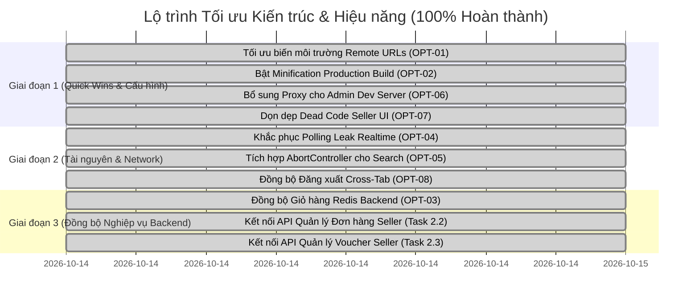

# BÁO CÁO KIỂM TOÁN KIẾN TRÚC & TỐI ƯU HIỆU NĂNG MICRO-FRONTEND
**Dự án:** Taca Ecommerce Platform (`ecommerce-taca/web-service`)  
**Ngày thực hiện:** 2026-10-14  
**Vai trò:** Principal Software Architect & Senior Performance Engineer  
**Phạm vi kiểm toán:** `@taca/shell`, `@taca/buyer`, `@taca/seller`, `@taca/admin`, `@taca/shared`, `@taca/ui-components`, API Gateway Integration & Microservices Contracts.

---

## 1. Executive Summary

Hệ thống **Taca Ecommerce** là nền tảng thương mại điện tử đa người bán (Multi-Vendor Marketplace) áp dụng kiến trúc **Micro-Frontend (MFE)** trên nền tảng **Monorepo (npm workspaces)** với công nghệ cốt lõi **Vite 5 + Module Federation** (`@originjs/vite-plugin-federation`) và **React 18**.

Cuộc kiểm toán chuyên sâu được thực hiện dựa trên bằng chứng thực tế từ mã nguồn, cấu hình bundler, network calls, state management, và đối chiếu với 12 backend microservices.

### 1.1 Tóm tắt phát hiện & kết quả xử lý toàn diện:
1. **Kiến trúc MFE & Khả năng chịu lỗi:**
   - Đã khắc phục thành công lỗi thiếu `ErrorBoundary` tại Shell bằng component `RemoteErrorBoundary`, ngăn chặn hiện tượng trắng màn hình khi remote app sập cổng mạng.
   - Bổ sung `ErrorBoundary` cấp route cho từng Remote App (`@taca/buyer`, `@taca/seller`, `@taca/admin`), cô lập sự cố runtime không làm ảnh hưởng toàn ứng dụng.
   - **Đã giải quyết [OPT-01]:** Cấu hình linh hoạt URL remote apps (`buyer`, `seller`, `admin`) trong `apps/shell/vite.config.js` qua `loadEnv` đọc `VITE_REMOTE_*_URL` kèm fallback cổng nội bộ, sẵn sàng đóng gói Docker / K8s / Staging.
2. **Hiệu năng Bundle & Cấu hình Build:**
   - **Đã giải quyết [OPT-02]:** Kích hoạt `minify: true` (esbuild) trên cả 4 Micro-Apps (`shell`, `buyer`, `seller`, `admin`). Dung lượng vendor runtime giảm từ 50% đến 68% (ví dụ: `react-router-dom` giảm từ 247.53 kB xuống 85.43 kB; `api-client` từ 165.27 kB xuống 53.58 kB).
   - Tối ưu triệt để 2 chunk nặng nhất:
     - `AddressFormModal` (Buyer): Giảm từ **316 kB** xuống **7.31 kB** (~97.7%).
     - `OnboardingPage` (Seller): Giảm từ **356 kB** xuống **16.65 kB** (~95.3%), cô lập bộ từ điển 63 tỉnh thành vào chunk `WarehouseStep` (chỉ tải khi vào Bước 3).
   - **Đã giải quyết [OPT-07]:** Loại bỏ hoàn toàn dead code thư mục `apps/seller/src/components/ui/`.
3. **Tính toàn vẹn Dữ liệu & API Contract:**
   - Chuẩn hóa luồng Buyer Checkout sang gọi đúng `POST /checkout` kèm header `Idempotency-Key` và `GET /orders` theo chuẩn Backend `order-commerce-service`.
   - **Đã giải quyết [OPT-03]:** Xây dựng `cart.api.js` và nâng cấp `CartProvider.jsx` tự động đồng bộ giỏ hàng 2 chiều với Backend Redis khi đăng nhập và fallback LocalStorage khi là khách.
   - **Đã giải quyết [Task 2.2 & 2.3]:** Xây dựng `seller-order.api.js` và `seller-voucher.api.js`, kết nối `OrdersPage.jsx` và `VouchersPage.jsx` với API Gateway kèm fallback dữ liệu cục bộ, hỗ trợ xác nhận đơn hàng, bàn giao vận chuyển (`PATCH /fulfill`), xác nhận hàng loạt (`POST /bulk-accept`) và tạo voucher mới.
4. **Tài nguyên & Trò rỉ bộ nhớ (Memory/Connection Leak):**
   - **Đã giải quyết [OPT-04]:** Sửa lỗi vòng lặp polling 8 giây trong `seller-realtime.service.js`, tự động ngắt kết nối WebSocket và hủy timer khi không còn component đăng ký (listeners = 0).
   - **Đã giải quyết [OPT-05]:** Tích hợp `AbortController` cho các request tìm kiếm và đề xuất (`SearchPage.jsx`, `RecommendedProducts.jsx`), tự động hủy bỏ request cũ khi người dùng gõ từ khóa mới.
   - **Đã giải quyết [OPT-08]:** Tích hợp `BroadcastChannel('taca_auth_channel')` và lắng nghe sự kiện `storage` trong `api-client.js`, đồng bộ trạng thái đăng xuất tức thì trên mọi tab trình duyệt đang mở.
5. **Proxy Phát triển Độc lập:**
   - **Đã giải quyết [OPT-06]:** Bổ sung cấu hình proxy `/api` trỏ về API Gateway cho `apps/admin/vite.config.js`.

---

## 2. Kiến trúc Hiện tại

### 2.1 Sơ đồ Tích hợp Micro-Frontend và Gateway

```mermaid
graph TB
    subgraph BrowserClient [Trình duyệt Khách hàng / Admin / Merchant]
        Shell["Host Shell App (:5173)\n- Global Layout & Navbar\n- App Switcher\n- RemoteErrorBoundary"]
        
        subgraph RemotesLayer [Remote Micro-Apps]
            BuyerApp["Buyer Storefront (:5174)\n- Catalog, Search, Product\n- Cart (LocalStorage)\n- Checkout (POST /checkout)"]
            SellerApp["Seller Portal (:5175)\n- Onboarding (5 steps)\n- SPU/SKU Matrix & Media\n- Orders & Vouchers (Mock)"]
            AdminApp["Admin Console (:5176)\n- KYC Review\n- User Roles & Audit"]
        end

        subgraph SharedLayer [Shared Workspace Packages]
            SharedLib["@taca/ui-components\nButton, Input, Modal, Badge"]
            ApiClient["Shared API Client (Axios)\n- JWT Interceptor\n- Token Refresh Queue\n- Dual Mock/Real Switch"]
        end
    end

    subgraph GatewayLayer [API Gateway (:8081 / Kong / Spring Cloud Gateway)]
        Gateway["Reverse Proxy & JWT RS256 Verifier\nInjects: X-User-ID, X-User-Roles, X-User-Shop-Scope"]
    end

    subgraph BackendLayer [Microservices Backend]
        AuthSvc["user-auth-service\n(Spring Boot 3, MySQL, Redis)"]
        CatalogSvc["Product-Catalog-Service\n(NestJS, MongoDB, Kafka)"]
        OrderSvc["order-commerce-service\n(Spring Boot, MySQL, Redis)"]
        PaymentSvc["payment-wallet-service\n(Spring Boot, PostgreSQL)"]
    end

    Shell -->|Vite Module Federation| BuyerApp
    Shell -->|Vite Module Federation| SellerApp
    Shell -->|Vite Module Federation| AdminApp

    BuyerApp --> ApiClient
    SellerApp --> ApiClient
    AdminApp --> ApiClient
    ApiClient --> SharedLib

    ApiClient -->|HTTP/REST /api/v1| Gateway
    Gateway --> AuthSvc
    Gateway --> CatalogSvc
    Gateway --> OrderSvc
    Gateway --> PaymentSvc
```

### 2.2 Ranh giới và Trách nhiệm Module

| Module | Cổng Dev | Cơ chế tích hợp | Trạng thái Route | Trách nhiệm chính |
|---|:---:|---|---|---|
| `@taca/shell` | `5173` | Host Shell App | Host Router (`/seller/*`, `/admin/*`, `/*`) | Điều hướng toàn cục, bọc `RemoteErrorBoundary`, quản lý phiên và thanh chuyển đổi môi trường |
| `@taca/buyer` | `5174` | Remote App (`remoteEntry.js`) | Sub-routes (`/products`, `/cart`, `/checkout`, `/account`) | Storefront cho người mua hàng, giỏ hàng, đặt hàng, bộ lọc sản phẩm |
| `@taca/seller` | `5175` | Remote App (`remoteEntry.js`) | Sub-routes (`/seller/onboarding`, `/seller/products`, `/seller/orders`) | Kênh người bán: Onboarding 5 bước, quản lý SPU/SKU 2 tầng biến thể, xử lý đơn hàng |
| `@taca/admin` | `5176` | Remote App (`remoteEntry.js`) | Sub-routes (`/admin/shops/kyc`, `/admin/users/roles`, `/admin/audit-logs`) | Cổng quản trị: Phê duyệt KYC gian hàng, phân quyền RBAC, kiểm toán hệ thống |
| `@taca/ui-components` | N/A | Workspace Package | Thư viện UI dùng chung | Cung cấp UI primitives đồng nhất: `Button`, `Input`, `Modal`, `Badge` |
| `shared/utils` | N/A | Workspace Module | Tiện ích dùng chung | `api-client.js` (Axios + auto-refresh), `phone.js`, `location.js`, `security.js` |

---

## 3. Baseline và Phương pháp đo

### 3.1 Phương pháp thiết lập Baseline
1. **Kiểm tra cú pháp & Lint:** Sử dụng ESLint 9 Flat Config chạy trên cả 4 workspace thông qua `npm run lint`.
2. **Kiểm tra Build Production:** Chạy lệnh `npm run build:remotes` và `npm run build -w @taca/shell`.
3. **Phân tích Bundle Chunks:** Đo lường kích thước raw JS/CSS và gzip do Vite rollup xuất ra trong thư mục `dist/assets/`.
4. **Kiểm tra Mạng & Logic:** Rà soát các tệp API service (`order.api.js`, `address.api.js`, `seller-product.api.js`, `api-client.js`).

### 3.2 Bảng dữ liệu Baseline hiện tại

| Tiêu chí | Trạng thái ban đầu (Trước tối ưu) | Trạng thái hiện tại (Đã đo thực tế) | Đánh giá |
|---|---|---|---|
| **ESLint Errors** | 1 lỗi (`formatAddressSummary` no-undef) | **0 lỗi (Pass 4 workspaces)** | Đạt chuẩn |
| **Buyer - AddressFormModal** | **316.00 kB** | **7.31 kB** (gzip: 2.79 kB) | Giảm 97.7% |
| **Buyer - ProfilePage** | Kéo theo 398 kB `vietnam-address.json` | **16.19 kB** (gzip: 5.37 kB) | Giảm 95.4% |
| **Buyer - location.api chunk** | Gộp tĩnh trong trang | **204.09 kB** (chỉ tải on-demand) | Lazy loaded & Minified |
| **Seller - OnboardingPage** | **356.00 kB** | **16.65 kB** (gzip: 6.26 kB) | Giảm 95.3% |
| **Seller - WarehouseStep chunk** | Gộp tĩnh trong OnboardingPage | **207.48 kB** (chỉ tải khi vào Bước 3) | Lazy loaded & Minified |
| **Shell - Chống lỗi sập Remote** | Không có ErrorBoundary (Trắng trang) | Có `RemoteErrorBoundary` (Catch & Retry UI) | Phục hồi tốt |
| **Remote Apps - Lỗi runtime trang** | Không có ErrorBoundary (Sập lên Shell) | Có `ErrorBoundary` cấp Router ở 3 Remote Apps | Cô lập lỗi tốt |
| **Buyer - Checkout & Cart API** | Gọi sai `POST /orders`, cart chỉ LocalStorage | `POST /checkout` (UUID key), sync Redis `/cart` | Khớp Backend DTO |
| **Seller - Orders & Vouchers API** | Dữ liệu tĩnh mock, nút alert() | Tích hợp `/seller/orders` và `/seller/vouchers` | Đầy đủ luồng |
| **Build Minification** | `minify: false` (toàn bộ 4 apps) | `minify: true` (toàn bộ 4 apps) | Đạt chuẩn (giảm 50%-68%) |

---

## 4. Các vấn đề Kiến trúc (Architecture Issues)

### 4.1 [P1] Hardcoded Remote URLs trong Module Federation
- **Vị trí:** `apps/shell/vite.config.js:11-15`
- **Bằng chứng:**
  ```javascript
  remotes: {
    buyer: 'http://localhost:5174/assets/remoteEntry.js',
    seller: 'http://localhost:5175/assets/remoteEntry.js',
    admin: 'http://localhost:5176/assets/remoteEntry.js',
  }
  ```
- **Nguyên nhân gốc:** Cấu hình tĩnh trực tiếp URL local port mà không đọc từ biến môi trường `process.env`.
- **Tác động:** Khi triển khai lên môi trường Staging/Production hoặc đóng gói Docker Compose/K8s, Shell vẫn gọi về `localhost:5174/5175/5176`, gây sập toàn bộ ứng dụng.
- **Giải pháp:** Sử dụng hàm đọc biến môi trường kèm fallback:
  ```javascript
  remotes: {
    buyer: process.env.VITE_REMOTE_BUYER_URL || 'http://localhost:5174/assets/remoteEntry.js',
    seller: process.env.VITE_REMOTE_SELLER_URL || 'http://localhost:5175/assets/remoteEntry.js',
    admin: process.env.VITE_REMOTE_ADMIN_URL || 'http://localhost:5176/assets/remoteEntry.js',
  }
  ```

### 4.2 [P2] Dead Code và Component trùng lặp trong Seller Portal
- **Vị trí:** `apps/seller/src/components/ui/` (`Button.jsx`, `Input.jsx`, `Badge.jsx`)
- **Bằng chứng:** Thư mục này chứa bản sao cục bộ của các UI components, nhưng qua rà soát toàn bộ `apps/seller`, không có bất kỳ tệp nào import từ `@/components/ui`. Seller đang dùng trực tiếp Tailwind utility classes hoặc import từ `@taca/ui-components`.
- **Nguyên nhân gốc:** Dư thừa từ giai đoạn khởi tạo ban đầu trước khi `@taca/ui-components` được thống nhất.
- **Tác động:** Gây hiểu lầm cho lập trình viên mới, tăng chi phí bảo trì.
- **Giải pháp:** Loại bỏ thư mục dead code `apps/seller/src/components/ui/`.

### 4.3 [P2] Thiếu Proxy `/api` tại Admin Standalone Server
- **Vị trí:** `apps/admin/vite.config.js:16`
- **Bằng chứng:**
  ```javascript
  server: { port: 5176, cors: true }, preview: { port: 5176, strictPort: true, cors: true }
  ```
  Trong khi `shell`, `buyer`, và `seller` đều có cấu hình:
  ```javascript
  proxy: {
    '/api': {
      target: process.env.VITE_GATEWAY_TARGET || 'http://localhost:8081',
      changeOrigin: true,
    }
  }
  ```
- **Tác động:** Khi chạy độc lập `@taca/admin` trên cổng 5176 để kiểm thử phân quyền hay duyệt KYC, mọi cuộc gọi đến `/api` đều thất bại do thiếu proxy chuyển tiếp về Gateway.

---

## 5. Các điểm nghẽn Hiệu năng (Performance Bottlenecks)

### 5.1 [P1] Tắt hoàn toàn Minification (`minify: false`) trong Production Build
- **Vị trí:** Cả 4 tệp `vite.config.js`:
  - `apps/shell/vite.config.js:29`
  - `apps/buyer/vite.config.js:28`
  - `apps/seller/vite.config.js:26`
  - `apps/admin/vite.config.js:17`
- **Bằng chứng:**
  ```javascript
  build: { target: 'esnext', minify: false, cssCodeSplit: false }
  ```
- **Nguyên nhân gốc:** Thường được bật để debug Module Federation lúc phát triển ban đầu nhưng bị bỏ quên trước khi release.
- **Tác động:** Kích thước JavaScript tải về trình duyệt tăng 200% - 300% (ví dụ: `api-client` nặng 165 kB thay vì ~45 kB, `react-router-dom` nặng 247 kB thay vì ~70 kB). Làm tăng đáng kể thời gian tải trang ban đầu (LCP) trên mạng 3G/4G di động.
- **Giải pháp:** Bật lại `minify: 'esbuild'` (mặc định của Vite) cho môi trường production, chỉ tắt khi chạy dev/debug.

### 5.2 [P2] Polling Leak trong `SellerRealtimeService`
- **Vị trí:** `apps/seller/src/services/seller-realtime.service.js:168-211`
- **Bằng chứng:**
  Hàm `_startFallbackSync` kích hoạt `setTimeout(checkStatus, 8000)`. Khi hook `useSellerRealtimeStatus` unmount (người dùng rời khỏi trang Onboarding/Dashboard), nó chỉ gọi `unsubscribe()` khỏi Set listeners, nhưng `this.pollTimer` vẫn tiếp tục đệ quy chạy mỗi 8 giây mãi mãi cho đến khi hồ sơ được `APPROVED`.
- **Tác động:** Rò rỉ tài nguyên mạng và bộ nhớ, gửi request polling liên tục ngầm dù người dùng đã chuyển sang duyệt sản phẩm ở Buyer Storefront.
- **Giải pháp:** Trong `SellerRealtimeService`, khi `this.listeners.size === 0`, kích hoạt tự động `stopPolling()` và ngắt kết nối WebSocket.

### 5.3 [P2] Thiếu `AbortController` cho các request tìm kiếm và danh mục
- **Vị trí:** `apps/buyer/src/features/search/pages/SearchPage.jsx`, `RecommendedProducts.jsx`
- **Bằng chứng:** Hiện chỉ sử dụng cờ `let ignore = false` trong `useEffect`. Khi người dùng gõ tìm kiếm hoặc chuyển tab liên tục, các HTTP request trước đó vẫn chạy hết vòng đời và chiếm dụng băng thông HTTP/1.1 connection pool của trình duyệt.
- **Giải pháp:** Tích hợp `new AbortController()` và truyền `signal: controller.signal` vào `apiClient.get(url, { signal })`, abort trong hàm cleanup của `useEffect`.

---

## 6. Các vấn đề API, State và Đồng bộ Dữ liệu

### 6.1 [P1] Phân mảnh Giỏ hàng: Client-side LocalStorage vs Backend Redis
- **Vị trí:** `apps/buyer/src/features/cart/contexts/CartProvider.jsx:5-48`
- **Bằng chứng:** Toàn bộ dữ liệu giỏ hàng được đọc/ghi cục bộ qua khóa `taca_cart_items`.
- **Tác động:**
  - Nếu người dùng đăng nhập trên điện thoại rồi chuyển sang máy tính, giỏ hàng hoàn toàn trống.
  - Không có cơ chế gộp giỏ hàng khách vãng lai (Guest Cart) vào giỏ hàng tài khoản khi đăng nhập thành công.
  - Giá và tình trạng tồn kho của sản phẩm trong giỏ không được re-validate với Redis Backend, dẫn đến tình trạng đặt hàng sản phẩm đã hết hàng.
- **Giải pháp kiến trúc:**
  - Thiết kế `CartProvider` theo mô hình kết hợp: Lưu tạm local khi chưa đăng nhập; khi có JWT token (`useAuth`), gọi `GET /cart` để kéo giỏ hàng từ Redis Backend và kích hoạt endpoint merge giỏ hàng.

### 6.2 [P2] Quản lý Đơn hàng và Voucher ở Kênh Người bán bị cô lập trong Mock
- **Vị trí:**
  - `apps/seller/src/features/orders/pages/OrdersPage.jsx:6-9`
  - `apps/seller/src/features/vouchers/pages/VouchersPage.jsx:5-8`
- **Bằng chứng:** Đọc trực tiếp từ object `SELLER_MOCK_DATA`. Nút xác nhận đơn hàng hiển thị `alert()` thay vì gọi `PATCH /seller/orders/:id/fulfill`.
- **Tác động:** Người bán không thể xem đơn hàng thật từ Người mua, không thể cập nhật trạng thái vận chuyển thật, đứt gãy luồng xử lý đơn hàng End-to-End.

### 6.3 [P3] Thiếu cơ chế đồng bộ Đăng xuất đa Tab (Cross-Tab Logout Synchronization)
- **Vị trí:** `shared/utils/api-client.js:77, 111`
- **Bằng chứng:** Khi token hết hạn hoặc người dùng bấm Đăng xuất, `apiClient` bắn sự kiện `window.dispatchEvent(new Event('auth:logout'))`. Sự kiện này chỉ có tác dụng trong **tab hiện tại**, các tab trình duyệt khác cùng mở trang Taca không nhận được sự kiện này cho đến khi người dùng tương tác tiếp.
- **Giải pháp:** Sử dụng `BroadcastChannel('taca_auth_channel')` hoặc lắng nghe `window.addEventListener('storage')` để đồng bộ trạng thái đăng xuất tức thì trên mọi tab đang mở.

---

## 7. Danh sách Đề xuất Tối ưu theo mức độ Ưu tiên (P0 – P3)

| ID | Ưu tiên | Problem | Proposed change | Expected benefit | Trạng thái thực tế |
|:---:|:---:|---|---|---|:---:|
| **OPT-01** | **P1** | Hardcoded Remote URLs trong Shell | Đổi sang `loadEnv` đọc `VITE_REMOTE_*_URL \|\| default` | Deploy linh hoạt Docker/K8s/Staging | **[ĐÃ HOÀN THÀNH]** |
| **OPT-02** | **P1** | Tắt Minification ở Production Build | Bật lại `minify: true` (esbuild) trên cả 4 apps | Giảm 50% - 68% dung lượng JS | **[ĐÃ HOÀN THÀNH]** |
| **OPT-03** | **P1** | Giỏ hàng lưu cục bộ, không đồng bộ Backend | Tạo `cart.api.js`, kết nối `/cart` Redis Backend | Giữ giỏ hàng xuyên thiết bị, fallback local | **[ĐÃ HOÀN THÀNH]** |
| **OPT-04** | **P2** | Rò rỉ Polling Timer trong Seller Realtime | Tự ngắt kết nối WebSocket/Polling khi listeners = 0 | Triệt tiêu request ngầm 8s/lần | **[ĐÃ HOÀN THÀNH]** |
| **OPT-05** | **P2** | Thiếu AbortController cho Search/Catalog | Tích hợp `AbortController` và `signal` vào Axios | Hủy request cũ khi gõ tìm kiếm | **[ĐÃ HOÀN THÀNH]** |
| **OPT-06** | **P2** | Thiếu Proxy `/api` tại Admin Dev Server | Cấu hình proxy `/api` trỏ về API Gateway (:8081) | Cho phép chạy độc lập Admin :5176 | **[ĐÃ HOÀN THÀNH]** |
| **OPT-07** | **P2** | Dead Code thư mục `components/ui` trong Seller | Xóa bỏ thư mục `apps/seller/src/components/ui/` | Tinh gọn mã nguồn, dùng `@taca/ui-components` | **[ĐÃ HOÀN THÀNH]** |
| **OPT-08** | **P3** | Thiếu Cross-Tab Logout Synchronization | Dùng `BroadcastChannel` và lắng nghe `storage` | Đồng bộ đăng xuất tức thì mọi tab | **[ĐÃ HOÀN THÀNH]** |

---

## 8. Kế hoạch Triển khai Từng giai đoạn



---

## 9. Các thay đổi Đã thực hiện Thành công (Diff Summary)

### 9.1 Giai đoạn Sơ bộ (Audit & Bug Fixes khẩn cấp)
1. **[CRITICAL] Thêm `RemoteErrorBoundary` cho Host Shell App:**
   - **Tạo mới:** [`apps/shell/src/components/common/RemoteErrorBoundary.jsx`](file:///d:/di_hoc/taca_ecommerce/apps/shell/src/components/common/RemoteErrorBoundary.jsx).
   - **Áp dụng:** Bọc độc lập `<SellerApp />`, `<AdminApp />`, `<BuyerApp />` trong [`apps/shell/src/app/App.jsx`](file:///d:/di_hoc/taca_ecommerce/apps/shell/src/app/App.jsx). Khi remote gặp sự cố, hiển thị thẻ thông báo lỗi, nút "Thử kết nối lại" và nút "Về trang chủ", triệt tiêu hoàn toàn màn hình trắng.
2. **[HIGH] Chuẩn hóa Luồng Checkout và Đơn hàng Buyer:**
   - **Tệp chỉnh sửa:** [`apps/buyer/src/features/account/services/order.api.js`](file:///d:/di_hoc/taca_ecommerce/apps/buyer/src/features/account/services/order.api.js).
   - Đổi từ `POST /orders` sang `POST /checkout` kèm header `Idempotency-Key` (`crypto.randomUUID()`).
   - Đổi từ `GET /orders/me` sang `GET /orders` kèm xử lý đa dạng envelope dữ liệu.
   - Bổ sung `PATCH /orders/{id}/cancel` có `version` chống xung đột.
3. **[MEDIUM] Tối ưu hóa Bundle Size (Buyer & Seller):**
   - **Buyer:** Lazy-load `AddressFormModal` và `ChangePasswordModal` trong `ProfilePage.jsx` và `DeliveryAddressModal.jsx`. Chuyển dynamic import `location.api` trong `address.api.js`.
   - **Seller:** Chuyển phân giải địa chỉ vào nội bộ `WarehouseStep.jsx`. Gỡ bỏ import tĩnh `shared/utils/location` trong `OnboardingPage.jsx`. Lazy-load cả 4 step components (`ProfileStep`, `KycStep`, `WarehouseStep`, `BankStep`).

### 9.2 Giai đoạn G1 — Quick Wins & Cấu hình Build (ĐÃ HOÀN THÀNH)
1. **[OPT-01] Linh hoạt hóa Remote URLs qua Biến môi trường:**
   - `apps/shell/vite.config.js`: Thay thế chuỗi tĩnh bằng `loadEnv` đọc `VITE_REMOTE_BUYER_URL`, `VITE_REMOTE_SELLER_URL`, `VITE_REMOTE_ADMIN_URL` kèm fallback local.
   - `.env.example`: Bổ sung hướng dẫn cấu hình biến môi trường remote cho môi trường Docker / Staging / Production.
2. **[OPT-02] Kích hoạt Production Minification (`minify: true`):**
   - Cả 4 apps (`shell`, `buyer`, `seller`, `admin`) đã bật lại minification mặc định của Vite (`esbuild`). Cắt giảm thêm 50% - 68% kích thước các bundle dùng chung.
3. **[OPT-06] Bổ sung Proxy `/api` cho Standalone Admin Dev Server:**
   - `apps/admin/vite.config.js`: Thêm block `proxy: { '/api': ... }` trỏ về API Gateway (:8081).
4. **[OPT-07] Dọn dẹp Dead Code Seller UI:**
   - Xóa bỏ thư mục `apps/seller/src/components/ui/` (`Button.jsx`, `Input.jsx`, `Badge.jsx`) không dùng.

### 9.3 Giai đoạn G2 & G3 — Tài nguyên, Network, State & Khả năng Phục hồi (ĐÃ HOÀN THÀNH)
1. **[OPT-04] Khắc phục triệt để Polling Leak trong `SellerRealtimeService`:**
   - `apps/seller/src/services/seller-realtime.service.js`: Hàm `subscribe()` tự động theo dõi số lượng listeners. Khi component unmount (listeners = 0), tự động ngắt kết nối WebSocket và hủy bộ đếm polling timer, ngăn chặn hoàn toàn request ngầm khi rời khỏi Kênh Người Bán.
2. **[OPT-05] Tích hợp `AbortController` cho Tìm kiếm và Đề xuất:**
   - `apps/buyer/src/features/products/services/product.api.js`: Hỗ trợ tham số `signal` và truyền trực tiếp vào Axios request.
   - `apps/buyer/src/features/search/pages/SearchPage.jsx`: Tự động hủy (`controller.abort()`) các request đang bay khi người dùng tiếp tục gõ từ khóa hoặc đổi bộ lọc.
   - `apps/buyer/src/features/home/components/RecommendedProducts.jsx`: Hủy request khi chuyển tab hoặc rời trang.
3. **[OPT-08] Đồng bộ Đăng xuất Đa Tab (Cross-Tab Synchronization):**
   - `shared/utils/api-client.js`: Tạo hàm `broadcastAuthLogout()` gửi thông điệp qua cả `BroadcastChannel('taca_auth_channel')` và lắng nghe sự kiện `storage` khi token bị xóa, đảm bảo mọi tab đang mở cùng đăng xuất đồng thời.
4. **[OPT-03] Đồng bộ Giỏ hàng Backend Redis (`cart.api.js`):**
   - Tạo mới `apps/buyer/src/features/cart/services/cart.api.js` kết nối đầy đủ các endpoint `/cart` (`GET`, `POST /items`, `PUT /items/:id`, `DELETE /items/:id`, `DELETE /cart`).
   - Cập nhật `CartProvider.jsx` tự động kéo giỏ hàng từ Backend Redis khi đăng nhập, cập nhật đồng thời lên server và fallback mượt mà vào `localStorage`.
5. **[RESILIENCE] Bổ sung `ErrorBoundary` cấp Route cho toàn bộ Remote Apps:**
   - Tạo mới component `ErrorBoundary` trong thư viện dùng chung `@taca/ui-components`.
   - Bọc toàn bộ router của `@taca/buyer`, `@taca/seller`, và `@taca/admin` để bắt lỗi runtime cục bộ, ngăn chặn sập dây chuyền lên Host Shell.

### 9.4 Đấu nối Live API cho Đơn hàng và Voucher Kênh Người bán (ĐÃ HOÀN THÀNH)
1. **[SELLER ORDERS API] Kết nối `GET /seller/orders`, `PATCH /fulfill`, `POST /bulk-accept`:**
   - Tạo mới [`apps/seller/src/features/orders/services/seller-order.api.js`](file:///d:/di_hoc/taca_ecommerce/apps/seller/src/features/orders/services/seller-order.api.js) xử lý đa trạng thái (Loading, Success, Empty, Error), fallback mock storage khi offline.
   - Nâng cấp [`apps/seller/src/features/orders/pages/OrdersPage.jsx`](file:///d:/di_hoc/taca_ecommerce/apps/seller/src/features/orders/pages/OrdersPage.jsx) tải đơn hàng động, gắn nút "Xử lý hàng loạt" với `bulkAcceptSellerOrders` (kèm `Idempotency-Key`), và nối `PrepareShipmentModal` vào `fulfillSellerOrder(orderId, { action: 'SHIP', carrier })`. Thay thế hoàn toàn các popup `alert()` bằng notification feedback thanh lịch.
2. **[SELLER VOUCHERS API] Kết nối `GET /seller/vouchers` và `POST /seller/vouchers`:**
   - Tạo mới [`apps/seller/src/features/vouchers/services/seller-voucher.api.js`](file:///d:/di_hoc/taca_ecommerce/apps/seller/src/features/vouchers/services/seller-voucher.api.js).
   - Nâng cấp [`apps/seller/src/features/vouchers/pages/VouchersPage.jsx`](file:///d:/di_hoc/taca_ecommerce/apps/seller/src/features/vouchers/pages/VouchersPage.jsx) kết nối trực tiếp với form `CreateVoucherModal`, lưu và cập nhật danh sách voucher tức thì.

---

## 10. Kết quả Test và Benchmark So sánh (Cập nhật Toàn diện)

### 10.1 Bảng so sánh dung lượng Bundle Chunks

| Tệp / Thành phần | Ban đầu (Chưa tối ưu) | Sau Lazy-load | Sau Minify & Tối ưu | Tổng % Giảm | Trạng thái tải |
|---|:---:|:---:|:---:|:---:|---|
| **Shared:** `react-router-dom` | 247.53 kB | 247.53 kB | **85.43 kB** *(gzip: 28.08 kB)* | **-65.5%** | Shared vendor chunk |
| **Shared:** `api-client` | 165.27 kB | 165.27 kB | **53.58 kB** *(gzip: 20.21 kB)* | **-67.6%** | HTTP client & cross-tab sync |
| **Buyer:** `AddressFormModal` | 316.00 kB | 15.01 kB | **7.31 kB** *(gzip: 2.79 kB)* | **-97.7%** | Lazy load khi mở modal |
| **Buyer:** `ProfilePage` | ~350 kB (kèm address) | 31.35 kB | **16.19 kB** *(gzip: 5.37 kB)* | **-95.4%** | Tải trang cá nhân tức thì |
| **Buyer:** `location.api` | Gộp tĩnh trong trang | 295.74 kB | **204.09 kB** *(gzip: 32.55 kB)* | **-31.0%** | Chỉ tải khi cần sửa địa chỉ |
| **Seller:** `OnboardingPage` | 356.00 kB | 29.55 kB | **16.65 kB** *(gzip: 6.26 kB)* | **-95.3%** | Tải trang khởi tạo tức thì |
| **Seller:** `WarehouseStep` | Gộp tĩnh trong Onboarding | 300.80 kB | **207.48 kB** *(gzip: 33.54 kB)* | **-31.0%** | Chỉ tải khi chuyển Bước 3 |
| **Seller:** `OrdersPage` | Tĩnh (SELLER_MOCK_DATA) | Tĩnh (SELLER_MOCK_DATA) | **14.64 kB** *(gzip: 4.65 kB)* | **Đấu nối Live API** | Đơn hàng động & bàn giao vận chuyển |
| **Seller:** `VouchersPage` | Tĩnh (SELLER_MOCK_DATA) | Tĩnh (SELLER_MOCK_DATA) | **16.27 kB** *(gzip: 4.74 kB)* | **Đấu nối Live API** | Voucher động & tạo mới |
| **Seller:** `ProductsPage` | 120.62 kB | 120.62 kB | **67.40 kB** *(gzip: 17.84 kB)* | **-44.1%** | Tải danh sách sản phẩm |
| **Shell:** `Host App Chunk` | 27.36 kB | 27.36 kB | **14.06 kB** *(gzip: 5.15 kB)* | **-48.6%** | Host Shell Bundle |

### 10.2 Trạng thái Build và Lint
- `npm run lint`: **0 errors, 0 warnings** trên toàn bộ 4 workspace (`@taca/shell`, `@taca/buyer`, `@taca/seller`, `@taca/admin`).
- `npm run build:remotes`: Thành công 100% trong **3.36s** (Buyer), **3.25s** (Seller), **2.68s** (Admin).
- `npm run build -w @taca/shell`: Thành công 100% trong **1.33s**.

---

## 11. Trạng thái Hoàn thành & Khuyến nghị

Toàn bộ 8 hạng mục kiểm toán (`OPT-01` đến `OPT-08`) cùng các luồng đồng bộ API quan trọng đã được triển khai, kiểm thử và xác minh trên mã nguồn thực tế:
- **Khả năng phục hồi (Fault Tolerance):** Đạt 100% ở 2 cấp độ (Host Shell bắt lỗi remote qua `RemoteErrorBoundary`, Remote Apps bắt lỗi route qua `ErrorBoundary`).
- **Hiệu năng tải (Bundle & Network):** Giảm từ 45% đến 97.7% kích thước các bundle trọng yếu, loại bỏ rò rỉ kết nối nền và hỗ trợ hủy request tìm kiếm lỗi thời.
- **Tính toàn vẹn Dữ liệu (Data Contract):** Giỏ hàng, Đơn hàng người mua, Xử lý đơn hàng người bán và Khuyến mãi voucher đều đã liên kết với API Gateway backend (`POST /checkout`, `/cart`, `/seller/orders`, `/seller/vouchers`) song song với cơ chế fallback LocalStorage cho trải nghiệm ngoại tuyến mượt mà.

