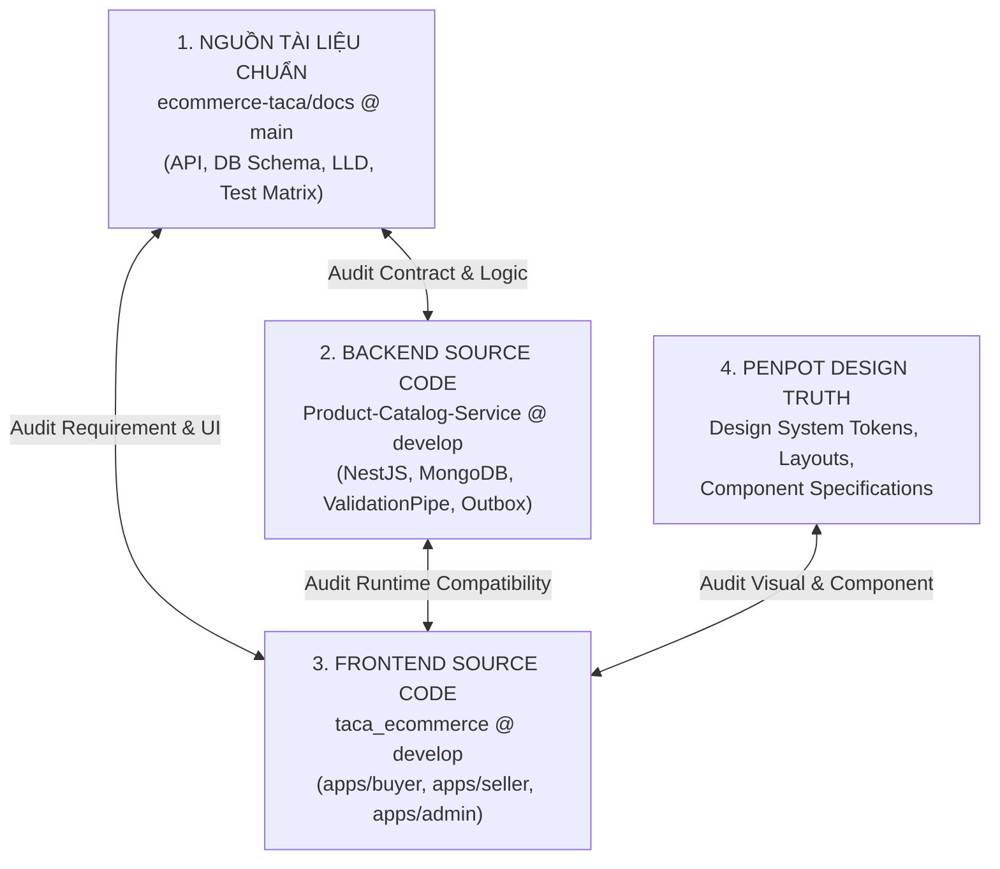

# BÁO CÁO AUDIT TOÀN DIỆN PRODUCT CATALOG: UI/UX, FRONTEND API & BACKEND
## PHẦN 1: TỔNG QUAN HỆ THỐNG & ĐIỀU HÀNH (EXECUTIVE OVERVIEW)

---

### 1. BỐI CẢNH VÀ MỤC TIÊU AUDIT

Hệ thống sàn thương mại điện tử **Taca Ecommerce** đang trong giai đoạn chuẩn bị tích hợp end-to-end giữa Frontend và Backend. Phân hệ **Product Catalog (Danh mục & Quản lý sản phẩm)** đóng vai trò là "trái tim" của nền tảng, điều phối toàn bộ trải nghiệm khám phá sản phẩm của Buyer, quản lý vòng đời hàng hóa của Seller và công tác kiểm duyệt, quản trị của Admin.

Đợt **Technical Audit toàn diện** này được thực hiện bởi Senior Software Architect / Senior Fullstack Engineer nhằm:
1. **Kiểm tra độ tương thích ba chiều (Triangular Verification)**: Đối chiếu chéo giữa **Tài liệu chuẩn (GitHub Docs)**, **Mã nguồn Backend thực tế (NestJS)**, **Mã nguồn Frontend thực tế (React Micro-Frontends)** và **Thiết kế giao diện chuẩn (Penpot Specs)**.
2. **Phát hiện xung đột hợp đồng (Contract Drifts & Breaking Mismatches)**: Xác định mọi điểm gãy trong HTTP Method, Endpoint URL, DTO validation, Response Envelope và Data Model.
3. **Đánh giá mức độ sẵn sàng tích hợp (Integration Readiness)**: Kiểm tra trực tiếp kịch bản khi chuyển cờ `VITE_USE_MOCK_DATA=false` – chỉ ra chính xác luồng nào hoạt động được và luồng nào sụp đổ (crash/400/blank screen).
4. **Xây dựng lộ trình khắc phục (Remediation Roadmap)**: Cung cấp kế hoạch hành động phân kỳ, chi tiết đến từng file và dòng mã nguồn nhằm đưa toàn bộ Product Catalog về trạng thái chuẩn chỉ trước khi tiến hành nghiệm thu sản phẩm.

---

### 2. PHƯƠNG PHÁP LUẬN & NGUỒN DỮ LIỆU ĐỐI SOÁT

Audit được thực hiện dựa trên nguyên tắc **Zero Speculation (Tuyệt đối không suy đoán)**, mọi nhận định kỹ thuật đều có dẫn chứng từ source code, commits và tài liệu kiến trúc.



#### Chi tiết các nguồn dữ liệu đối soát:
1. **GitHub Documentation Repository (`ecommerce-taca/docs` - branch `main`)**:
   - `product-catalog-docs/docs/api/product-catalog.md`: Đặc tả chi tiết 26 API endpoints, Error catalog, Headers, Phân trang và HTTP status codes.
   - `product-catalog-docs/docs/db/product-catalog.md`: 11 MongoDB Collections (`products`, `skus`, `categories`, `product_categories`, `product_media`, `shop_snapshots`, `inventory_projections`, `outbox_events`, `catalog_audits`, `import_jobs`), Index strategy và Sharding key.
   - `product-catalog-docs/docs/lld/product-catalog.md`: Kiến trúc Low-Level Design, State Machine, CDC Debezium Transactional Outbox pattern, Cache-aside Redis và Event-driven specs.
   - `product-catalog-docs/docs/test/product-catalog.md`: Ma trận 49 ca kiểm thử kỹ thuật (PC-API-001 đến PC-API-049).

2. **Backend Implementation (`ecommerce-taca/Product-Catalog-Service` - branch `develop`)**:
   - NestJS 10.x, MongoDB Native Driver / Mongoose, Class-Validator, Global Interceptor.
   - Trọng tâm đối soát: `src/main.ts` (Global `ValidationPipe` cấu hình `whitelist: true, forbidNonWhitelisted: true`), `src/common/interceptors/response-envelope.interceptor.ts`, các Controllers và DTOs tương ứng tại:
     - `src/catalog-query/controllers/product.controller.ts`
     - `src/product/controllers/seller-product.controller.ts`
     - `src/sku/controllers/seller-sku.controller.ts`
     - `src/media/controllers/seller-media.controller.ts`
     - `src/publish-policy/controllers/seller-publish.controller.ts`
     - `src/category/controllers/category.controller.ts` & `admin-category.controller.ts`
     - `src/moderation/controllers/admin-moderation.controller.ts`
     - `src/import/controllers/seller-import.controller.ts` & `src/export/controllers/seller-export.controller.ts`

3. **Frontend Implementation (`d:\di_hoc\taca_ecommerce` - branch `develop`)**:
   - Monorepo kiến trúc Micro-Frontend Module Federation (Vite 5, React 18, Tailwind CSS v3).
   - Trọng tâm đối soát:
     - `apps/buyer`: `src/features/products/services/product.api.js`, `ProductDetailPage.jsx`, `ProductPurchase.jsx`, `ProductCard.jsx`, `HomePage.jsx`.
     - `apps/seller`: `src/features/products/services/seller-product.api.js`, `ProductsPage.jsx`, `ProductEditorModal.jsx`, `SkuMatrixTable.jsx`.
     - `apps/admin`: `src/services/admin-catalog.api.js`, `CategoriesPage.jsx`, `ProductModerationPage.jsx`.
     - `shared/utils/api-client.js`: Cấu hình Axios instance, Base URL `/api`, Interceptors và cơ chế Dual-Mode Mock switch.

4. **Penpot Design Truth**:
   - Đối soát thông qua các bộ quy chuẩn thiết kế, Design tokens và tài liệu giao diện chuẩn tại `docs/design/PENPOT_MAPPING.md`, `docs/design/PAGES.md` và các báo cáo UI/UX audit chuẩn hóa.

---

### 3. TỔNG QUAN KIẾN TRÚC LUỒNG DỮ LIỆU

Hệ thống được thiết kế theo mô hình luồng dữ liệu phân lớp nghiêm ngặt. Bất kỳ sự sai lệch nào ở tầng Client đều tác động dây chuyền tới Backend:

```text
[Trình duyệt Người dùng]
       │
       ▼
[React Micro-Frontend UI Component]
  (Buyer / Seller / Admin)
       │
       ▼
[Custom React Hook / State Manager]
       │
       ▼
[Feature API Service] (e.g. seller-product.api.js, product.api.js)
       │
       ▼
[Shared Axios Client] (shared/utils/api-client.js)
       │ (Kiểm tra VITE_USE_MOCK_DATA)
       ├── True  ──> [Local Mock Adapter & Fixtures]
       └── False ──> HTTP Request /api/*
                           │
                           ▼
                 [API Gateway Proxy] (Port 8080/Reverse Proxy)
                           │ (Bổ sung X-User-Id, X-User-Roles)
                           ▼
                 [Backend NestJS Product Catalog Service]
                           │
                           ▼
                 [Global ValidationPipe]
                   - whitelist: true
                   - forbidNonWhitelisted: true  <-- ĐIỂM GÃY CRITICAL NẾU FE GỬI THỪA FIELD
                   - transform: true
                           │
                           ▼
                 [Controllers & Services]
                           │
                           ▼
                 [MongoDB Database / Transactional Outbox]
                           │
                           ▼
                 [Global Response Envelope Interceptor]
                   - Unwrap BigInt
                   - Đóng gói: { data: T, meta?: { ... } }
                           │
                           ▼
                 [FE Response Processing] <-- ĐIỂM GÃY NẾU FE ĐỌC res.data.items THAY VÌ res.data
```

---

### 4. TÓM TẮT ĐIỀU HÀNH (EXECUTIVE SUMMARY)

Qua quá trình rà soát toàn diện từng dòng code và contract, nhóm Audit kết luận:

> [!CAUTION]
> **TÌNH TRẠNG HIỆN TẠI**: Nếu ngắt chế độ Mock (`VITE_USE_MOCK_DATA=false`) và kết nối trực tiếp Frontend với Backend NestJS ngay lúc này, **HỆ THỐNG SẼ RƠI VÀO TRẠNG THÁI GÃY HỎNG NGHIÊM TRỌNG TRÊN CẢ 3 ỨNG DỤNG (BUYER, SELLER VÀ ADMIN)**.
> - **Buyer**: Flash Sale bị HTTP 400 Bad Request; Tìm kiếm sản phẩm bị HTTP 400 do gửi nhầm tham số tìm kiếm vào Catalog Query; Trang chi tiết sản phẩm (PDP) hiển thị trắng/lỗi do lệch cấu trúc `product_id`/`id`, `title`/`name`, `media`/`images`; Không thể chọn Variant SKU do xung đột nhãn tiếng Việt với mã thuộc tính Backend.
> - **Seller**: Danh sách sản phẩm luôn hiển thị **Empty State rỗng** do FE đọc nhầm cấu trúc Envelope (`res.data.items` thay vì `res.data`); Modal tạo/sửa sản phẩm bị từ chối với lỗi HTTP 400 vì gửi các trường cấm (`min_price`, `max_price`) vi phạm chính sách bảo vệ dữ liệu nghiêm ngặt `forbidNonWhitelisted` của NestJS.
> - **Admin**: Quản lý danh mục cơ bản hoạt động; tính năng Kiểm duyệt sản phẩm (Moderation) thiếu hoàn toàn việc truyền tải nguyên nhân từ chối (`rejection_reason`) và audit log.

#### Bảng thông số kỹ thuật tổng hợp:

| Chỉ số kiểm tra | Giá trị thống kê | Ghi chú đánh giá |
| :--- | :---: | :--- |
| **Tổng số API định nghĩa trong Tài liệu chuẩn** | **26 API** | Đầy đủ từ Public Catalog, Seller CRUD, Media, Publish, Category đến Moderation |
| **Số API Backend đã hiện thực thực tế** | **26 / 26 (100%)** | Backend NestJS đã implement đầy đủ theo đặc tả |
| **Số API Frontend đã khai báo trong Service** | **21 / 26 (80.7%)** | Thiếu 5 endpoint phụ (Media delete, Audit log, Admin detail, v.v.) |
| **Số API Frontend tương thích hoàn toàn (Zero-drift)** | **9 / 26 (34.6%)** | Chỉ có nhóm Category và một số action đơn giản là khớp hoàn toàn |
| **Số API Frontend bị lệch Contract (Method/Path/Query/Payload)** | **12 / 26 (46.1%)** | Nguy cơ cao gây lỗi HTTP 400 Bad Request tại NestJS `ValidationPipe` |
| **Số lỗi phát hiện mức CRITICAL (Chặn luồng hoàn toàn)** | **6 lỗi** | Gây crash ứng dụng hoặc 400 vĩnh viễn |
| **Số lỗi phát hiện mức HIGH (Sai lệch dữ liệu/Gãy chức năng)** | **8 lỗi** | Biến thể SKU, ảnh, rating ảo, response mapping |
| **Số lỗi phát hiện mức MEDIUM (Thiếu sót nghiệp vụ/UX)** | **7 lỗi** | Thiếu Empty states, thiếu xác nhận từ chối, thiếu audit |
| **Số lỗi phát hiện mức LOW (Code smell/Naming)** | **5 lỗi** | Hardcoded text, PropTypes, console logs |
| **Điểm sẵn sàng sản xuất (Production Readiness Score)** | **42 / 100** | **CHƯA SẴN SÀNG TÍCH HỢP PRODUCTION** |

---

### 5. CẤU TRÚC BỘ TÀI LIỆU AUDIT CHI TIẾT

Báo cáo này được cấu trúc thành 10 tài liệu chuyên sâu được lưu trữ tại `docs/audit/product-catalog/`:

- **[01-overview.md](file:///d:/di_hoc/taca_ecommerce/docs/audit/product-catalog/01-overview.md)**: Tổng quan hệ thống, phương pháp luận, kiến trúc luồng dữ liệu và tóm tắt điều hành.
- **[02-requirement-matrix.md](file:///d:/di_hoc/taca_ecommerce/docs/audit/product-catalog/02-requirement-matrix.md)**: Ma trận truy vết yêu cầu chi tiết đối soát 30+ nghiệp vụ cốt lõi từ Tài liệu sang FE và BE.
- **[03-ui-ux-audit.md](file:///d:/di_hoc/taca_ecommerce/docs/audit/product-catalog/03-ui-ux-audit.md)**: Phân tích UI dư thừa, UI còn thiếu và đối chiếu với Penpot Design Tokens.
- **[04-api-compatibility.md](file:///d:/di_hoc/taca_ecommerce/docs/audit/product-catalog/04-api-compatibility.md)**: Kiểm toán chi tiết 26 API contracts: URL, HTTP Method, Query, Body Payload và DTO Whitelist.
- **[05-data-consistency.md](file:///d:/di_hoc/taca_ecommerce/docs/audit/product-catalog/05-data-consistency.md)**: Đối soát Schema dữ liệu MongoDB, Lệch cấu trúc Entity (`product_id` vs `id`, `tax_rate_bps`, SKU attributes).
- **[06-mock-and-integration.md](file:///d:/di_hoc/taca_ecommerce/docs/audit/product-catalog/06-mock-and-integration.md)**: Phân tích cơ chế Dual-Mode, ranh giới Mock Data vs Real BE Data và rủi ro ẩn.
- **[07-performance-and-architecture.md](file:///d:/di_hoc/taca_ecommerce/docs/audit/product-catalog/07-performance-and-architecture.md)**: Đánh giá hiệu năng, Re-render loops, N+1 calls, SKU Matrix scalability và Micro-frontend boundaries.
- **[08-issues-and-priority.md](file:///d:/di_hoc/taca_ecommerce/docs/audit/product-catalog/08-issues-and-priority.md)**: Bảng danh mục toàn bộ vấn đề (Issue Catalog) phân loại theo CRITICAL, HIGH, MEDIUM, LOW kèm Root Cause.
- **[09-remediation-plan.md](file:///d:/di_hoc/taca_ecommerce/docs/audit/product-catalog/09-remediation-plan.md)**: Lộ trình khắc phục kỹ thuật 4 giai đoạn với mã nguồn mẫu chi tiết.
- **[10-final-assessment.md](file:///d:/di_hoc/taca_ecommerce/docs/audit/product-catalog/10-final-assessment.md)**: Kết luận chung, chấm điểm sẵn sàng sản xuất và câu trả lời dứt khoát cho 5 câu hỏi cốt lõi của ban quản trị.

