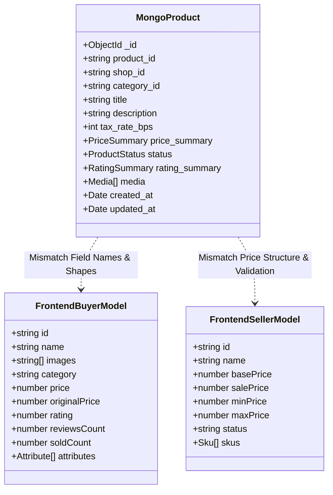
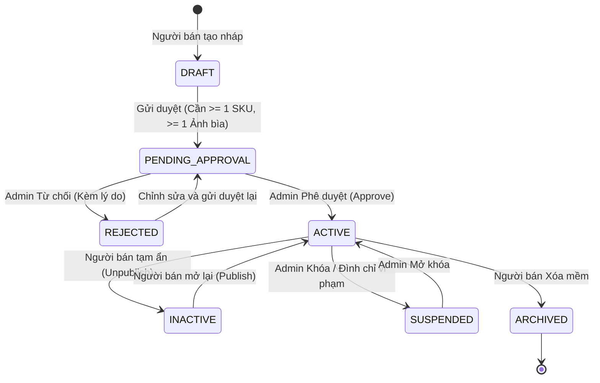

# BÁO CÁO AUDIT TOÀN DIỆN PRODUCT CATALOG: UI/UX, FRONTEND API & BACKEND
## PHẦN 5: ĐỐI SOÁT TÍNH ĐỒNG BỘ DỮ LIỆU & MÔ HÌNH THỰC THỂ (DATA CONSISTENCY AUDIT)

---

### 1. ĐỐI SOÁT SCHEMA MONGODB VỚI DỮ LIỆU FRONTEND

Hệ thống Backend sử dụng 11 MongoDB Collections được định nghĩa tại `db/product-catalog.md`. Dưới đây là bảng đối chiếu chi tiết giữa cấu trúc dữ liệu Backend thực tế và cách Frontend đang tiếp nhận, xử lý:



---

### 2. PHÂN TÍCH CHI TIẾT CÁC ĐỘ LỆCH THUỘC TÍNH (FIELD-LEVEL DRIFTS)

#### 2.1. Lệch định danh sản phẩm: `product_id` vs `id`
- **Backend Model**: Database sử dụng `product_id` (kiểu chuỗi UUID/CUID duy nhất) làm khóa nghiệp vụ chính và `_id` làm khóa nội bộ MongoDB.
- **Frontend Model**: Nhiều component trên `apps/buyer` và `apps/seller` truy cập trực tiếp qua thuộc tính `product.id`.
- **Hậu quả**: Khi nhận dữ liệu từ Backend, `product.id` là `undefined`. Khi click vào card sản phẩm để điều hướng sang trang chi tiết (`/products/${product.id}`), URL trở thành `/products/undefined`, kích hoạt lỗi điều hướng 404.
- **Giải pháp bắt buộc**: Cần tạo Adapter chuẩn hóa trên Frontend: `id: product.product_id || product.id || product._id`.

---

#### 2.2. Lệch tên sản phẩm: `title` vs `name`
- **Backend Model**: Trường tên sản phẩm được chuẩn hóa là `title` (phù hợp với chuẩn TMĐT quốc tế và ElasticSearch).
- **Frontend Model**:
  - `ProductDetailPage.jsx`: render `{product?.name}`.
  - `ProductCard.jsx`: render `{product?.name}`.
- **Hậu quả**: Toàn bộ tiêu đề sản phẩm trên trang chủ và trang chi tiết của Buyer hiển thị trắng trơn (hoặc chỉ hiện fallback nếu có).
- **Giải pháp**: Chuẩn hóa trường: `title: product.title || product.name || ''`.

---

#### 2.3. Lệch cấu trúc hình ảnh: `media: [{ url, is_cover, position }]` vs `images: string[]`
- **Backend Model**: `product_media` là một mảng object gồm đầy đủ metadata:
  ```json
  "media": [
    {
      "media_id": "med_12345",
      "url": "https://cdn.taca.vn/products/img1.webp",
      "type": "IMAGE",
      "is_cover": true,
      "position": 0
    }
  ]
  ```
- **Frontend Model**: `ProductDetailPage.jsx` và `ProductCard.jsx` đang đọc `product.images` (mảng chuỗi) hoặc `product.image` (chuỗi URL đơn).
- **Hậu quả**: Vì `product.images` là `undefined`, code Frontend fallback về hình ảnh giữ chỗ mặc định `https://placehold.co/400`. Toàn bộ ảnh sản phẩm thật tải lên từ Seller không bao giờ được hiển thị đến Buyer.
- **Giải pháp**: Xây dựng helper trích xuất ảnh cover:
  ```javascript
  const coverImage = product.media?.find(m => m.is_cover)?.url 
    || product.media?.[0]?.url 
    || product.image 
    || 'https://placehold.co/400';
  ```

---

#### 2.4. Lệch thuế suất: `tax_rate_bps` (Basis Points) vs Thuế phần trăm (%)
- **Backend Model**: Quy định lưu trữ `tax_rate_bps` kiểu số nguyên Basis Points ($1\% = 100 \text{ bps}$, ví dụ thuế VAT 10% lưu là `1000`). Điều này nhằm tránh hoàn toàn sai số dấu phẩy động (Floating point arithmetic) trong tính toán tài chính và đối soát thuế.
- **Frontend Model**: `ProductEditorModal.jsx` nhập thuế dưới dạng số nguyên phần trăm (ví dụ: `10`).
- **Hậu quả**: Nếu FE gửi trực tiếp `10` lên BE, Backend sẽ hiểu thuế suất là $10 \text{ bps} = 0.1\%$. Doanh thu thuế và tính toán giá trị gia tăng của đơn hàng sẽ bị giảm gấp 100 lần so với thực tế!
- **Giải pháp**: Chuyển đổi hai chiều:
  - Khi gửi lên BE: `tax_rate_bps = Math.round(Number(percent) * 100)`.
  - Khi hiển thị ra FE: `percent = (tax_rate_bps / 100).toFixed(1)`.

---

#### 2.5. Điểm gãy chết người: Xung đột khớp biến thể SKU (SKU Attribute Matching)
- **Vị trí**: `apps/buyer/src/features/products/components/ProductPurchase.jsx` (dòng 55 - 75).
- **Hiện trạng mã nguồn Frontend**:
  ```javascript
  // Người dùng bấm chọn nút biến thể trên UI:
  const handleSelectAttribute = (attrLabel, value) => {
    setSelectedAttributes(prev => ({ ...prev, [attrLabel]: value }));
  };
  // Khi tìm SKU khớp:
  const matchedSku = product.skus?.find(sku => {
    return Object.entries(selectedAttributes).every(([label, value]) => {
      return sku.attributes?.[label] === value; // GÃY TẠI ĐÂY
    });
  });
  ```
- **Tại Database Backend**: Thuộc tính của SKU được lưu dưới dạng normalized key bằng tiếng Anh (`key-value`):
  ```json
  "attributes": {
    "color": "black",
    "size": "XL",
    "material": "cotton"
  }
  ```
  Trong khi đó, `selectedAttributes` trên giao diện người dùng lại lưu nhãn tiếng Việt hiển thị (Label):
  ```javascript
  selectedAttributes = {
    "Màu sắc": "Đen",
    "Kích cỡ": "XL"
  };
  ```
- **Hậu quả**: Biểu thức `sku.attributes["Màu sắc"]` luôn luôn trả về `undefined`. Kết quả là `matchedSku` không bao giờ tìm thấy, hệ thống fallback về `product.skus[0]` hoặc vô hiệu hóa nút "Mua ngay" / "Thêm vào giỏ". Khách hàng hoàn toàn không thể mua được đúng biến thể mình đã chọn!
- **Giải pháp**: Backend và Frontend phải thống nhất sử dụng thuộc tính có cả `key` lẫn `display_name`, và hàm tìm kiếm biến thể bắt buộc phải so khớp theo `key` chuẩn hóa.

---

### 3. VÒNG ĐỜI TRẠNG THÁI SẢN PHẨM & TÍNH NHẤT QUÁN OUTBOX CDC

Hệ thống áp dụng kiến trúc **Event-Driven Architecture** với mẫu hình **Transactional Outbox & Debezium CDC** (`lld/product-catalog.md#4.2`):

```text
[Seller/Admin Action]
       │
       ▼
[MongoDB Atomic Transaction]
   ├── 1. Ghi bảng `products` (status transition)
   └── 2. Ghi bảng `outbox_events` (event payload)
       │
       ▼ (Debezium CDC tailing Oplog)
[Kafka Topic: catalog.product.events]
       │
       ├── Consumer: Search-Service (Cập nhật chỉ mục ElasticSearch)
       ├── Consumer: Recommendation-Service (Huấn luyện mô hình gợi ý)
       └── Consumer: Inventory-Service (Khởi tạo kho SKU)
```

#### Ma trận chuyển đổi trạng thái (State Machine):



#### Vấn đề nhất quán cuối cùng (Eventual Consistency) trên Frontend:
- Khi Người bán thực hiện tạo sản phẩm hoặc gửi duyệt, Backend xử lý lưu database thành công và trả về response ngay lập tức. Tuy nhiên, việc sản phẩm xuất hiện trên bộ máy tìm kiếm (Buyer Storefront) phải trải qua hàng đợi Kafka Debezium (độ trễ khoảng 100ms - 500ms).
- **Rủi ro trên FE**: Nếu sau khi Admin bấm "Phê duyệt" hoặc Seller bấm "Đăng bán", màn hình lập tức điều hướng sang Buyer Storefront và gọi tìm kiếm, sản phẩm có thể chưa xuất hiện ngay.
- **Khuyến nghị**: Frontend cần hiển thị thông báo "Sản phẩm đã được phê duyệt thành công và đang được đồng bộ lên sàn (ước tính 1-2 phút)".

