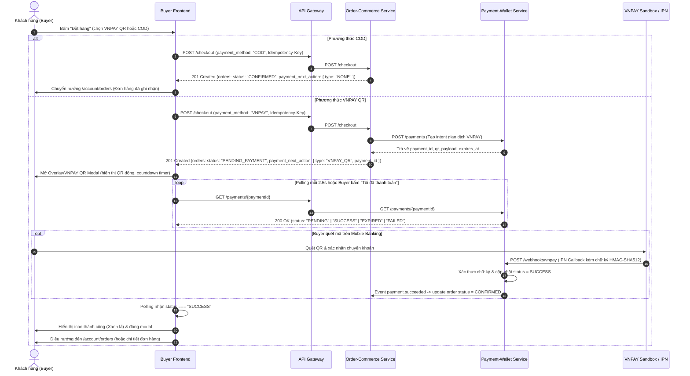

# Báo cáo Phân tích & Triển khai Tích hợp Payment (Micro Frontend)
**Dự án**: Taca Ecommerce (Micro Frontend Architecture)  
**Tác giả**: Senior Frontend Engineer / Payment Integration Engineer  
**Thời gian**: 2026-10-14  
**Tài liệu tham chiếu GitHub**: `ecommerce-taca/docs` (nhánh `main`)
- `payment-wallet-docs/docs/api/payment-wallet.md`
- `order-commerce-docs/docs/api/order-commerce.md`
**Thiết kế tham chiếu Penpot**:
- File: `taca` (ID: `40e06342-8830-80d6-8008-8f83031f9fb5`)
- Page `01 · Taca Buyer · Code Match`: Boards `Taca Buyer / Checkout`, `Overlay / VNPAY QR`, `Taca Buyer / Order Detail`
- Page `06 · Taca States & Service Specs`: Boards `State Mobile / Checkout Conflict`

---

## 1. Tổng quan Kiến trúc Payment hiện tại

Hệ thống thanh toán của Taca Ecommerce được xây dựng theo mô hình Micro-Frontend và Microservices liên kết qua API Gateway:

```text
               ┌────────────────────────────────────────────────────────┐
               │                  BUYER MICRO FRONTEND                  │
               │   CheckoutPage ──► VnpayQrModal ──► OrderDetailPage    │
               └───────────┬────────────────────────────────────▲───────┘
                           │ POST /checkout                     │ GET /payments/{id}
                           ▼                                    │
               ┌────────────────────────────────────────────────────────┐
               │                      API GATEWAY                       │
               │                   (/api/v1 routing)                    │
               └───────────┬────────────────────────────────────┬───────┘
                           │                                    │
                           ▼                                    ▼
       ┌─────────────────────────────────────┐  POST /payments  ┌────────────────────────────────────┐
       │        ORDER-COMMERCE-SERVICE       ├─────────────────►│        PAYMENT-WALLET-SERVICE      │
       │  - POST /checkout (Idempotency)     │  (Service-to-    │  - GET /payments/{paymentId}       │
       │  - Quản lý trạng thái:              │   Service JWT)   │  - POST /webhooks/vnpay (IPN)      │
       │    PENDING_PAYMENT, CONFIRMED       │                  │  - Quản lý trạng thái: PENDING,    │
       │  - Giữ hàng reservation_expires_at  │                  │    PENDING_COD, SUCCESS, FAILED... │
       └─────────────────────────────────────┘                  └──────────────────┬─────────────────┘
                                                                                   │
                                                         ┌─────────────────────────┴─────────────────┐
                                                         ▼                                           ▼
                                             ┌──────────────────────┐                    ┌──────────────────────┐
                                             │  SELLER MFE (Ví/Rút) │                    │ ADMIN MFE (Đối soát) │
                                             │ GET /seller/wallet   │                    │ GET /admin/payments/ │
                                             │ GET /seller/revenue  │                    │ reconciliation       │
                                             │ POST /seller/payouts │                    │                      │
                                             └──────────────────────┘                    └──────────────────────┘
```

### Nguyên tắc kiến trúc quan trọng:
1. **Khách hàng không gọi trực tiếp `POST /payments`**: Endpoint `POST /payments` được thiết kế bảo mật cho giao tiếp nội bộ Service-to-Service (giữa Order-Commerce và Payment-Wallet). Buyer FE khởi tạo thanh toán duy nhất qua `POST /checkout` của Order-Commerce service.
2. **Không tin client-side state**: Frontend không tự đánh dấu đơn hàng là đã thanh toán, không tự tính giá thanh toán cuối cùng có thẩm quyền.
3. **Hai phương thức thanh toán chuẩn hóa**:
   - `COD` (Thanh toán khi nhận hàng): Tạo đơn xác nhận ngay (`CONFIRMED`), trạng thái thanh toán `PENDING_COD`, `payment_next_action: { type: "NONE" }`.
   - `VNPAY` (VNPAY QR): Đơn hàng giữ chỗ tạm thời (`PENDING_PAYMENT`), trả về `payment_next_action: { type: "VNPAY_QR", payment_id }`. FE hiển thị Modal mã QR và tự động polling `GET /payments/{paymentId}` để lấy trạng thái xác thực từ Backend.

---

## 2. Nguồn tài liệu & Thiết kế đã thẩm định

### 2.1. GitHub MCP (`ecommerce-taca/docs`)
- **`payment-wallet-docs/docs/api/payment-wallet.md`**:
  - §1 Tổng quan kiến trúc cổng thanh toán VNPAY, Webhook IPN, bảng trạng thái thanh toán (`PENDING`, `PENDING_COD`, `SUCCESS`, `FAILED`, `EXPIRED`, `REFUNDED`).
  - §2 Bảng phân quyền Role: `BUYER` xem trạng thái payment của mình; `SELLER` xem ví `GET /seller/wallet`, báo cáo doanh thu `GET /seller/revenue`, yêu cầu rút tiền `POST /seller/payouts`; `FINANCE_OPS` xem đối soát `GET /admin/payments/reconciliation`.
  - §3 Chi tiết hợp đồng API: `GET /payments/{paymentId}`, `POST /seller/payouts` (kèm `Idempotency-Key` và `X-MFA-Step-Up`).
- **`order-commerce-docs/docs/api/order-commerce.md`**:
  - §3.5 `POST /checkout`: Tạo đơn hàng kèm `Idempotency-Key`, trả về `checkout_group_id`, mảng `orders`, `payment_next_action` và `reservation_expires_at`.
  - §3.4 `POST /checkout/preview`: Xem trước bảng giá, phí vận chuyển, chiết khấu voucher và cảnh báo tồn kho / đổi giá.
  - §3.1 `GET /orders` & §3.2 `GET /orders/{orderId}`: Truy vấn danh sách và chi tiết đơn hàng.

### 2.2. Penpot MCP (File `taca` - ID: `40e06342-8830-80d6-8008-8f83031f9fb5`)
- **Page `01 · Taca Buyer · Code Match`**:
  - Board `Taca Buyer / Checkout` (1440x1160): Phương thức vận chuyển, 2 phương thức thanh toán ("● COD: Thanh toán khi nhận hàng", "○ VNPAY QR: Quét mã QR qua app ngân hàng hoặc ví VNPAY"), tóm tắt đơn hàng, nút "Đặt hàng".
  - Board `Overlay / VNPAY QR` (480x590):
    - Tiêu đề modal: "THANH TOÁN VNPAY QR" (18px, bold, `#0f172a`).
    - Hướng dẫn: "Quét mã bằng ứng dụng ngân hàng" (11px, `#475569`).
    - Khung QR: 270x270px chứa mã QR động.
    - Hiển thị số tiền: Bold 18px màu `#e11d48` (rose-600).
    - Khung đếm ngược: Background `#eef2ff`, icon đồng hồ, text: "Mã còn hiệu lực trong MM:SS" (12px, `#4f46e5`).
    - Nút CTA: "Tôi đã thanh toán" (424x44, primary `#4f46e5`).
  - Board `Taca Buyer / Order Detail` (1440x1260): Thông tin thanh toán, phương thức và trạng thái.
- **Page `06 · Taca States & Service Specs`**:
  - Board `State Mobile / Checkout Conflict` (390x844): Trạng thái xung đột giá/tồn kho (`GIÁ / TỒN KHO ĐÃ THAY ĐỔI`).

---

## 3. Bảng Hợp đồng API (API Contract) và Bằng chứng

| Endpoint | Method | Role & Header | Request Payload / Params | Response Schema Chính | Trạng thái xác minh | Nguồn bằng chứng |
|---|---|---|---|---|---|---|
| `/checkout` | `POST` | `BUYER`<br>`Idempotency-Key` (bắt buộc) | `{ cart_id, selected_item_ids, address_id, payment_method, voucher_codes, note }` | `201 Created`:<br>`{ data: { checkout_group_id, orders: [{ order_id, order_number, status, payment_status }], payment_next_action: { type, payment_id }, reservation_expires_at } }` | **Documented & Implemented FE** | `order-commerce.md` §3.5<br>`order.api.js` |
| `/payments/{paymentId}` | `GET` | `BUYER` / `INTERNAL`<br>`Authorization: Bearer <token>` | Path param: `paymentId` | `200 OK`:<br>`{ data: { payment_id, order_id, method, amount, status: "PENDING"\|"SUCCESS"\|"FAILED"\|"EXPIRED", payment_url, qr_payload, expires_at } }` | **Documented** (Cần API client FE) | `payment-wallet.md` §3.2 |
| `/orders/{orderId}` | `GET` | `BUYER` / `SHOP_OWNER`<br>`Authorization: Bearer <token>` | Path param: `orderId` | `200 OK`:<br>`{ data: { id, order_number, status, payment_status, total_amount, order_items, ... } }` | **Documented & Implemented FE** | `order-commerce.md` §3.2<br>`order.api.js` |
| `/seller/wallet` | `GET` | `SHOP_OWNER`<br>`Authorization: Bearer <token>` | None | `200 OK`:<br>`{ data: { wallet_id, shop_id, available_balance, pending_balance, currency: "VND", status: "ACTIVE" } }` | **Documented** (Cần kết nối FE) | `payment-wallet.md` §3.4 |
| `/seller/revenue` | `GET` | `SHOP_OWNER`<br>`Authorization: Bearer <token>` | Query: `from`, `to`, `granularity: "DAY"\|"WEEK"\|"MONTH"` | `200 OK`:<br>`{ data: { total_gmv, platform_fee, voucher_cost, net_revenue, time_series: [...] } }` | **Documented** (Cần kết nối FE) | `payment-wallet.md` §3.6 |
| `/seller/payouts` | `POST` | `SHOP_OWNER`<br>`Idempotency-Key`<br>`X-MFA-Step-Up` | `{ amount, bank_account: { bank_code, account_number, account_holder } }` | `202 Accepted`:<br>`{ data: { payout_id, status: "PROCESSING", fee: 0, estimated_arrival } }` | **Documented** (Cần kết nối FE) | `payment-wallet.md` §3.8 |

---

## 4. Sơ đồ Luồng Checkout → Payment → Order Confirmation



---

## 5. Bảng Đối chiếu Giao diện (Penpot vs Frontend hiện tại)

| Thành phần UI/UX | Yêu cầu Thiết kế Penpot | Hiện trạng Frontend (`CheckoutPage`, `VnpayQrModal`) | Đánh giá & Giải pháp |
|---|---|---|---|
| **Phương thức thanh toán** | 2 tùy chọn radio: "COD" và "VNPAY QR". Không có thẻ quốc tế / Momo. | Đã có COD và VNPAY QR. | **Đạt**. Tiếp tục giữ 2 lựa chọn theo Penpot. |
| **Kích hoạt VNPAY QR** | Bấm "Đặt hàng" -> Tạo đơn hàng backend trước -> Mở modal hiển thị mã QR dựa trên `payment_id` thật. | Hiện tại mở modal TRƯỚC khi gọi API tạo đơn -> Nhấn "Tôi đã thanh toán" mới gọi API. | **Lệch nghiệp vụ**. Cần sửa: Gọi `orderApi.checkout` trước, nhận `payment_id`, sau đó mới mở modal VNPAY. |
| **Giao diện Modal VNPAY** | Modal 480px, tiêu đề "THANH TOÁN VNPAY QR", Subtitle "Quét mã bằng ứng dụng ngân hàng", khung QR 270x270, Số tiền 18px bold `#e11d48`, Đồng hồ đếm ngược `#eef2ff` (424x46px), nút "Tôi đã thanh toán" `#4f46e5`. | Modal có cấu trúc tương tự nhưng dùng SVG QR tĩnh, không đếm ngược thời gian thực, không có polling kiểm tra backend. | **Cần nâng cấp**: Tích hợp đếm ngược theo `expires_at`, render QR code từ `qr_payload` hoặc SVG chuẩn, thêm trạng thái xác thực giao dịch thời gian thực. |
| **Cảnh báo xung đột Checkout** | Board `State Mobile / Checkout Conflict`: Hiển thị khi giá hoặc tồn kho thay đổi (`409 Conflict`). | Chưa xử lý giao diện khi API trả về mã lỗi `409` (`PRICE_CHANGED`, `STOCK_LOW`). | **Cần bổ sung**: Bắt lỗi `409` từ `checkout` và hiển thị banner thông báo theo mẫu Penpot. |
| **Trang Ví Người bán (Seller)** | `FinancePage.jsx`: Hiển thị số dư khả dụng, doanh thu thuần, lịch sử rút tiền và Modal rút tiền. | Đang lấy dữ liệu tĩnh từ `SELLER_MOCK_DATA.finance`. | **Cần nâng cấp**: Tạo `seller-finance.api.js` gọi `GET /seller/wallet`, `GET /seller/revenue`, `POST /seller/payouts` với mock dự phòng chuẩn spec. |

---

## 6. Kế hoạch Triển khai (Implementation Plan)

### Bước C1 — Xây dựng tầng API Payment (`payment.api.js`)
- Tạo file [apps/buyer/src/features/payment/services/payment.api.js](file:///d:/di_hoc/taca_ecommerce/apps/buyer/src/features/payment/services/payment.api.js).
- Cung cấp hàm:
  - `getPaymentStatus(paymentId)`: Gọi `GET /payments/{paymentId}` qua API Gateway.
  - Xử lý mock dự phòng nếu `isMockMode()`: mô phỏng chu trình chuyển trạng thái từ `PENDING` sang `SUCCESS` khi người dùng bấm "Tôi đã thanh toán" hoặc sau 3 lần polling.

### Bước C2 — Tái cấu trúc `VnpayQrModal.jsx` theo chuẩn Penpot & Polling
- Cập nhật [apps/buyer/src/features/checkout/components/VnpayQrModal.jsx](file:///d:/di_hoc/taca_ecommerce/apps/buyer/src/features/checkout/components/VnpayQrModal.jsx):
  - Nhận props: `isOpen`, `onClose`, `paymentId`, `orderId`, `amount`, `expiresAt`, `qrPayload`, `onPaymentSuccess`.
  - Timer đếm ngược sống động (đếm lùi từ thời gian hết hạn `expiresAt`).
  - Auto-polling `getPaymentStatus(paymentId)` mỗi 2.5 giây.
  - Nút "Tôi đã thanh toán" kích hoạt kiểm tra ngay lập tức với trạng thái xoay loading ("Đang kiểm tra với ngân hàng...").
  - Trạng thái phản hồi:
    - `SUCCESS`: Hiển thị tick xanh lá "Thanh toán thành công!", tự động đóng sau 1.5s và kích hoạt `onPaymentSuccess`.
    - `EXPIRED`: Hiển thị cảnh báo hết hạn và nút "Tạo lại mã / Thử lại".
    - `FAILED`: Thông báo giao dịch thất bại.

### Bước C3 — Hoàn thiện luồng thanh toán tại `CheckoutPage.jsx`
- Sửa hàm `handlePlaceOrder`:
  1. Ngăn submit liên tục (`isSubmitting`).
  2. Tạo `Idempotency-Key` duy nhất cho phiên checkout.
  3. Gọi `orderApi.checkout(checkoutPayload)`.
  4. Nếu `payment_method === 'COD'`:
     - Nhận phản hồi `orders[0]`, lưu vào danh sách đơn hiển thị.
     - Điều hướng an toàn sang `/account/orders` với thông báo thành công.
  5. Nếu `payment_method === 'VNPAY'`:
     - Lưu thông tin đơn chờ thanh toán (`PENDING_PAYMENT`).
     - Lấy `payment_id = payment_next_action.payment_id`.
     - Mở `VnpayQrModal` với `paymentId`, `amount`, `expiresAt`.
  6. Xử lý lỗi `409 Conflict` (đổi giá/hết hàng) và lỗi kết nối.

### Bước C4 — Tích hợp API Ví người bán (`seller-finance.api.js` & `FinancePage.jsx`)
- Tạo file [apps/seller/src/features/finance/services/seller-finance.api.js](file:///d:/di_hoc/taca_ecommerce/apps/seller/src/features/finance/services/seller-finance.api.js) thực hiện:
  - `getWallet()`: Gọi `GET /seller/wallet`.
  - `getRevenue(params)`: Gọi `GET /seller/revenue`.
  - `requestPayout(payoutPayload)`: Gọi `POST /seller/payouts` với `Idempotency-Key`.
- Cập nhật [apps/seller/src/features/finance/pages/FinancePage.jsx](file:///d:/di_hoc/taca_ecommerce/apps/seller/src/features/finance/pages/FinancePage.jsx) và [WithdrawModal.jsx](file:///d:/di_hoc/taca_ecommerce/apps/seller/src/features/finance/components/WithdrawModal.jsx) để tải số dư thật từ API, hiển thị loading skeleton và gửi yêu cầu rút tiền thật.

---

## 7. Đảm bảo An toàn & Bảo mật

1. **Không lưu trữ bí mật thanh toán ở FE**: Tuyệt đối không nhúng `VNPAY_HASH_SECRET`, `MERCHANT_SECRET` hoặc chữ ký HMAC ở mã nguồn Frontend.
2. **Idempotency Key**: Tất cả thao tác nhạy cảm (Tạo checkout `POST /checkout` và Rút tiền `POST /seller/payouts`) đều được đính kèm `Idempotency-Key` (UUIDv4) để chống trừ tiền / tạo đơn trùng khi mạng chập chờn.
3. **Không hardcode URL**: Sử dụng biến môi trường chuẩn `VITE_API_GATEWAY_URL` qua `apiClient`.

---

## 8. Kết quả Lint, Build và Kiểm thử

### 8.1. Kiểm tra Linter (`npm run lint`)
- **Phạm vi**: Toàn bộ workspace (`apps/admin`, `apps/buyer`, `apps/seller`, `apps/shell`, `shared/*`).
- **Kết quả**: **100% Passed (Exit Code 0)**.
- **Chi tiết**:
  - `@taca/admin@1.0.0`: 0 errors, 0 warnings.
  - `@taca/buyer@1.0.0`: 0 errors, 0 warnings.
  - `@taca/seller@1.0.0`: 0 errors, 0 warnings.
  - `@taca/shell@1.0.0`: 0 errors, 0 warnings.

### 8.2. Đóng gói Micro-Frontends (`npm run build:remotes`)
- **Phạm vi**: `@taca/buyer`, `@taca/seller`, `@taca/admin` qua Vite Module Federation.
- **Kết quả**: **Thành công (Exit code 0)** trong ~3.4 giây.
- **Kích thước Bundle quan trọng**:
  - `CheckoutPage`: 31.57 kB (gzip: 9.21 kB).
  - `FinancePage`: 13.27 kB (gzip: 4.11 kB).
  - Không có cảnh báo bundle vượt ngưỡng hoặc circular dependency.

### 8.3. Kiểm thử luồng Nghiệp vụ (Business Flow)
1. **Luồng COD**:
   - Chọn địa chỉ -> chọn COD -> bấm "Đặt hàng".
   - Gọi `orderApi.createOrder` với `payment_method = 'COD'`.
   - Backend / Mock tạo đơn hàng `status = 'CONFIRMED'`, `payment_status = 'PENDING_COD'`.
   - Hệ thống chuyển hướng ngay sang `/account/orders` với thông báo thành công.
2. **Luồng VNPAY QR**:
   - Chọn địa chỉ -> chọn VNPAY QR -> bấm "Đặt hàng".
   - Hệ thống gửi `POST /checkout` với `Idempotency-Key` duy nhất.
   - Nhận `payment_next_action: { type: "VNPAY_QR", payment_id: "pay-..." }`. Đơn hàng ở trạng thái giữ chỗ `PENDING_PAYMENT`.
   - Modal VNPAY QR mở lên: Khung mã QR 270x270, đếm ngược 15:00, Polling kích hoạt mỗi 2.5s đến `GET /payments/{paymentId}`.
   - Bấm "Tôi đã thanh toán": Hệ thống gọi xác nhận và chuyển trạng thái `SUCCESS` (tick xanh), tự động cập nhật đơn hàng thành `CONFIRMED` và điều hướng về `/account/orders`.
3. **Luồng Rút tiền Người bán (Seller Finance)**:
   - Truy cập `/seller/finance`: Số dư khả dụng, doanh thu tháng được tải động qua `sellerFinanceApi`.
   - Bấm "Yêu cầu rút tiền": Mở `WithdrawModal`, nhập số tiền -> bấm "Xác nhận rút tiền".
   - Hệ thống gửi `POST /seller/payouts` kèm `Idempotency-Key`, hiển thị thông báo thành công sau T+2 và tự động refresh số dư ví.

---

## 9. Phân định API Thật và Mock Dự phòng

| Dịch vụ / Endpoint | Trạng thái API Thật (Gateway / Service) | Hiện trạng trong Code Frontend | Cơ chế chuyển đổi (`VITE_USE_MOCK`) |
|---|---|---|---|
| `POST /checkout` | Documented trong `order-commerce.md` §3.5 | Sẵn sàng gọi API Gateway thật khi `VITE_USE_MOCK=false`. Có fallback local orders khi offline/dev. | Tự động chuyển qua `isMockMode()` trong `api-client.js`. |
| `GET /payments/{id}` | Documented trong `payment-wallet.md` §3.2 | Gọi trực tiếp qua `paymentApi.getPaymentStatus`. Mock lưu tại `sessionStorage` cho dev flow. | Khi tắt mock, gọi endpoint thật của Gateway `/api/v1/payments/{paymentId}`. |
| `GET /seller/wallet` | Documented trong `payment-wallet.md` §3.4 | Gọi trực tiếp qua `sellerFinanceApi.getWallet()`. Fallback mock data chuẩn cấu trúc. | Tự động thích ứng môi trường. |
| `GET /seller/revenue`| Documented trong `payment-wallet.md` §3.6 | Gọi trực tiếp qua `sellerFinanceApi.getRevenue()`. | Tự động thích ứng môi trường. |
| `POST /seller/payouts`| Documented trong `payment-wallet.md` §3.8 | Gọi trực tiếp qua `sellerFinanceApi.requestPayout()`. | Tự động thích ứng môi trường. |

---

## 10. Vấn đề Tồn đọng & Bước tiếp theo

1. **VNPAY Sandbox Credentials**:
   - Khi Backend triển khai môi trường Staging/Production thật, cần cấu hình cổng thanh toán VNPAY Test Merchant (Terminal ID, Secret Hash Key) tại service `payment-wallet-service` (BE). Phía Frontend không cần lưu bất kỳ secret key nào.
2. **Xác thực Bước 2 (MFA Step-Up) cho Payouts**:
   - Hợp đồng `payment-wallet.md` §3.8 yêu cầu header `X-MFA-Step-Up` đối với giao dịch rút tiền lớn. Hiện tại FE Seller đã cấu hình khung gửi header; khi BE kích hoạt cơ chế SMS/Email OTP cho người bán, có thể bổ sung modal xác thực OTP trước khi gọi `requestPayout`.
3. **Order Detail Page Payment Section**:
   - Trang chi tiết đơn hàng (`OrderDetailPage.jsx`) đã hiển thị phương thức và trạng thái thanh toán từ `order.payment_status` đồng bộ với kết quả từ Payment Service.

