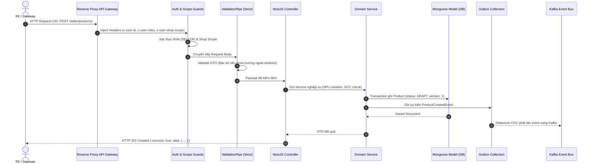
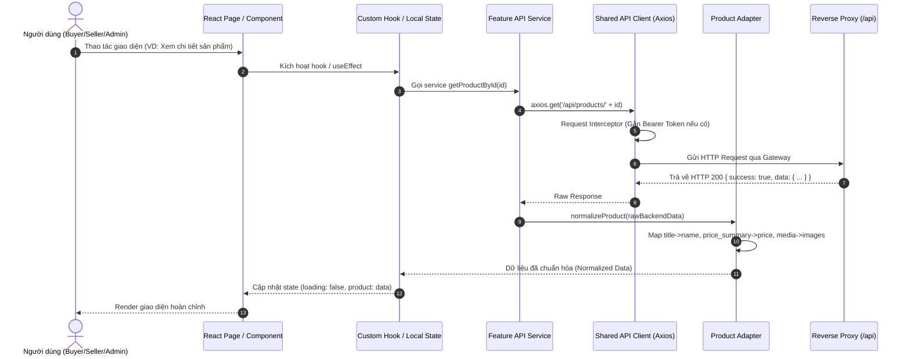

# BÁO CÁO AUDIT TOÀN DIỆN PRODUCT CATALOG – TACA ECOMMERCE
## PHẦN 01: KHẢO SÁT HỆ THỐNG VÀ PHÂN TÍCH REPOSITORY (REPOSITORY ANALYSIS)

---

### 1. KHẢO SÁT SOURCE CODE BACKEND

#### 1.1. Thông tin định danh Repository
- **Tên Repository**: `ecommerce-taca/Product-Catalog-Service`
- **Đường dẫn**: `https://github.com/ecommerce-taca/Product-Catalog-Service`
- **Nhánh kiểm toán (Branch)**: `develop`
- **Commit định danh (Head Commit)**: `6572eceb18ad618d5c521d11d27a750cf5306eae`
- **Thông điệp Commit**: `fix(projections): read shop name from auth-user shop.updated snapshot` (PR #44)

#### 1.2. Công nghệ và Thư viện cốt lõi (Tech Stack)
- **Runtime & Framework**: Node.js v20 LTS, **NestJS v10.x**, TypeScript v5.x.
- **Database Engine**: **MongoDB v7.x** (Replica Set) quản lý qua **Mongoose ODM v8.x**.
- **Message Broker & Event Sourcing**: **Apache Kafka v3.x**, tích hợp **Debezium CDC** giám sát Outbox collection.
- **Caching & Rate Limiting**: **Redis v7.x** (in-memory caching cho Categories và Public Product detail).
- **Validation & Transformation**: `class-validator`, `class-transformer` với cấu hình nghiêm ngặt:
  ```typescript
  app.useGlobalPipes(new ValidationPipe({
    whitelist: true,
    forbidNonWhitelisted: true,
    transform: true,
  }));
  ```
- **Tài liệu kiểm thử tích hợp**: File `product-catalog-api.http` (35.8 KB) định nghĩa chi tiết toàn bộ các luồng kiểm thử từ Unit đến E2E cho 10 kịch bản nghiệp vụ.

#### 1.3. Cấu trúc thư mục Backend
```text
Product-Catalog-Service/
├── src/
│   ├── main.ts                          # Bootstrap ứng dụng, cấu hình global pipes, interceptors
│   ├── app.module.ts                    # Root module kết nối MongoDB, Kafka, Redis
│   ├── common/
│   │   ├── guards/
│   │   │   ├── auth.guard.ts            # Kiểm tra header x-user-id và Bearer token
│   │   │   ├── roles.guard.ts           # Kiểm tra header x-user-roles (SELLER, CATALOG_ADMIN, ...)
│   │   │   └── shop-scope.guard.ts      # Kiểm tra header x-user-shop-scope cho tenant seller
│   │   ├── interceptors/
│   │   │   ├── transform.interceptor.ts # Bọc response chuẩn { success: true, data: ... }
│   │   │   └── logging.interceptor.ts
│   │   ├── filters/
│   │   │   └── http-exception.filter.ts # Xử lý chuẩn hóa lỗi { error_code, message, details }
│   │   └── constants/
│   ├── modules/
│   │   ├── categories/                  # Quản lý danh mục sản phẩm (Tree, Tax rate, Slug)
│   │   ├── products/                    # Quản lý SPU Drafts, Lifecycle (Submit, Publish, Archive)
│   │   ├── skus/                        # Quản lý biến thể SKU, Attributes matrix, Barcode
│   │   ├── media/                       # Presigned S3 upload url, Complete upload, SHA256 verify
│   │   ├── moderation/                  # Admin phê duyệt, khóa (Block/Unblock), từ chối (Reject)
│   │   ├── import-export/               # Xử lý Bulk Import Excel background job & Export CSV/XLSX
│   │   └── projections/                 # Consumer Kafka đồng bộ shop name, inventory projections
│   └── config/                          # Cấu hình môi trường (MongoDB URI, Kafka Brokers, S3 Keys)
├── product-catalog-api.http             # 35.8 KB HTTP Test Suite chính thống của BE
├── docker-compose.yml
└── package.json
```

#### 1.4. Luồng thực thi chi tiết của Backend (BE Execution Flow)


---

### 2. KHẢO SÁT SOURCE CODE FRONTEND

#### 2.1. Thông tin định danh Monorepo
- **Tên dự án**: `taca_ecommerce`
- **Mô hình kiến trúc**: **Monorepo Workspaces** kết hợp **Micro-Frontend (Module Federation)**
- **Công nghệ Build & Bundler**: Vite v5.x, `@originjs/vite-plugin-federation`
- **UI Framework & Styling**: React v18.x, Tailwind CSS v3.4, `@tailwindcss/forms`
- **Icon System**: `lucide-react` (Tuân thủ triệt để quy tắc 100% vector icons, không dùng emoji)

#### 2.2. Bản đồ phân vùng ứng dụng (Workspaces & Ports)
| Workspace | Tên Package | Cổng Dev | Vai trò kiến trúc |
| :--- | :--- | :---: | :--- |
| `apps/shell` | `@taca/shell` | **5173** | Host Container, Global Routing, Auth Context, Module Federation Fallback & Crash Protection |
| `apps/buyer` | `@taca/buyer` | **5174** | Remote MFE: Storefront, Trang chủ, Danh mục, Chi tiết sản phẩm, Giỏ hàng, VNPAY Checkout |
| `apps/seller` | `@taca/seller` | **5175** | Remote MFE: Merchant Portal, Quản lý kho sản phẩm, Tạo/sửa SPU & SKU, Bulk Import Excel |
| `apps/admin` | `@taca/admin` | **5176** | Remote MFE: Quản trị hệ thống, Cây danh mục, Kiểm duyệt sản phẩm (Approve/Reject/Block), Audit Logs |
| `shared/ui-components` | `@taca/ui-components` | Shared | Thư viện Design System dùng chung: Button, Modal, Input, Badge, Table, Pagination, Skeleton |
| `shared/utils` | `@taca/utils` | Shared | Shared Axios Client, Tầng Adapter (`product.adapter.js`), Formatters (VND, Date), Token Storage |

#### 2.3. Cấu trúc thư mục Frontend (Tập trung Product Catalog)
```text
taca_ecommerce/
├── apps/
│   ├── shell/                           # Host Shell quản lý routing cấp cao & module remotes
│   ├── buyer/
│   │   └── src/features/products/
│   │       ├── components/
│   │       │   ├── ProductCard.jsx       # Card sản phẩm trên storefront (hỗ trợ coverImage/media)
│   │       │   ├── ProductPurchase.jsx   # Khối chọn biến thể SKU, giá tiền động, số lượng
│   │       │   └── ProductGallery.jsx    # Thư viện ảnh chi tiết
│   │       ├── pages/
│   │       │   ├── ProductDetailPage.jsx # Màn hình chi tiết sản phẩm (kèm normalizeProduct)
│   │       │   ├── CategoryLandingPage.jsx# Danh sách sản phẩm theo danh mục
│   │       │   └── SearchPage.jsx        # Tìm kiếm & Bộ lọc nâng cao
│   │       └── services/
│   │           └── product.api.js        # API Client Buyer (getProducts, getProductById, getCategories)
│   ├── seller/
│   │   └── src/features/products/
│   │       ├── components/
│   │       │   ├── ProductEditorModal.jsx# Modal tạo/sửa sản phẩm 4 bước (Basic, Category, SKU, Media)
│   │       │   ├── ProductImportModal.jsx# Modal nhập file Excel hàng loạt
│   │       │   └── ProductTable.jsx      # Bảng danh sách sản phẩm với badge trạng thái
│   │       ├── pages/
│   │       │   └── ProductsPage.jsx      # Quản lý sản phẩm (Tabs: Tất cả, Đang bán, Chờ duyệt, Từ chối...)
│   │       └── services/
│   │           └── seller-product.api.js # API Client Seller (Draft, Categories, SKUs, Media, Lifecycle)
│   └── admin/
│       └── src/
│           ├── features/
│           │   ├── categories/pages/AdminCategoriesPage.jsx # Quản lý danh mục cây & Thuế suất
│           │   ├── products/pages/AdminProductsPage.jsx     # Kiểm duyệt sản phẩm (Approve/Reject/Block)
│           │   └── audits/pages/AdminAuditLogsPage.jsx      # Nhật ký kiểm toán sản phẩm
│           └── services/
│               └── admin-catalog.api.js  # API Client Admin (Categories, Moderation, Audits)
└── shared/
    ├── ui-components/                   # Zero-logic UI components
    └── utils/
        ├── api-client.js                # Axios client cấu hình baseURL: /api, Bearer token
        └── adapters/
            └── product.adapter.js       # Tầng Adapter chuẩn hóa dữ liệu BE -> FE
```

#### 2.4. Luồng thực thi chi tiết của Frontend (FE Execution Flow)


---

### 3. BẢNG ÁNH XẠ MODULE GIỮA FRONTEND VÀ BACKEND

| Phân hệ nghiệp vụ | Module Backend tương ứng | Feature Frontend tương ứng | Đánh giá độ phủ |
| :--- | :--- | :--- | :---: |
| **SPU Draft & Management** | `modules/products` | `apps/seller/src/features/products` | **100% Đầy đủ** |
| **SKU & Variant Matrix** | `modules/skus` | `apps/seller/src/features/products/components/ProductEditorModal` | **95% Tốt** |
| **Category Tree & Tax** | `modules/categories` | `apps/admin/src/features/categories` & `apps/buyer` | **100% Đầy đủ** |
| **Media S3 Upload Flow** | `modules/media` | `apps/seller/src/features/products/services/seller-product.api.js` | **85% Tốt** |
| **Product Lifecycle** | `modules/products` (Submit/Publish/Archive) | `apps/seller/src/features/products/pages/ProductsPage.jsx` | **100% Đầy đủ** |
| **Buyer Storefront** | `modules/products` (Public Controller) | `apps/buyer/src/features/products` | **95% Tốt** |
| **Bulk Import / Export** | `modules/import-export` | `apps/seller/src/features/products/components/ProductImportModal` | **75% Cần bổ sung polling** |
| **Admin Moderation** | `modules/moderation` | `apps/admin/src/features/products/pages/AdminProductsPage.jsx` | **100% Đầy đủ** |
| **Catalog Audit Trail** | `modules/moderation` (Audit logs) | `apps/admin/src/features/audits` | **70% API có, cần UI view** |
| **Inventory Projections** | `modules/projections` (Kafka consumer) | `apps/buyer/src/features/products/components/ProductPurchase` | **85% Hiển thị số lượng** |

