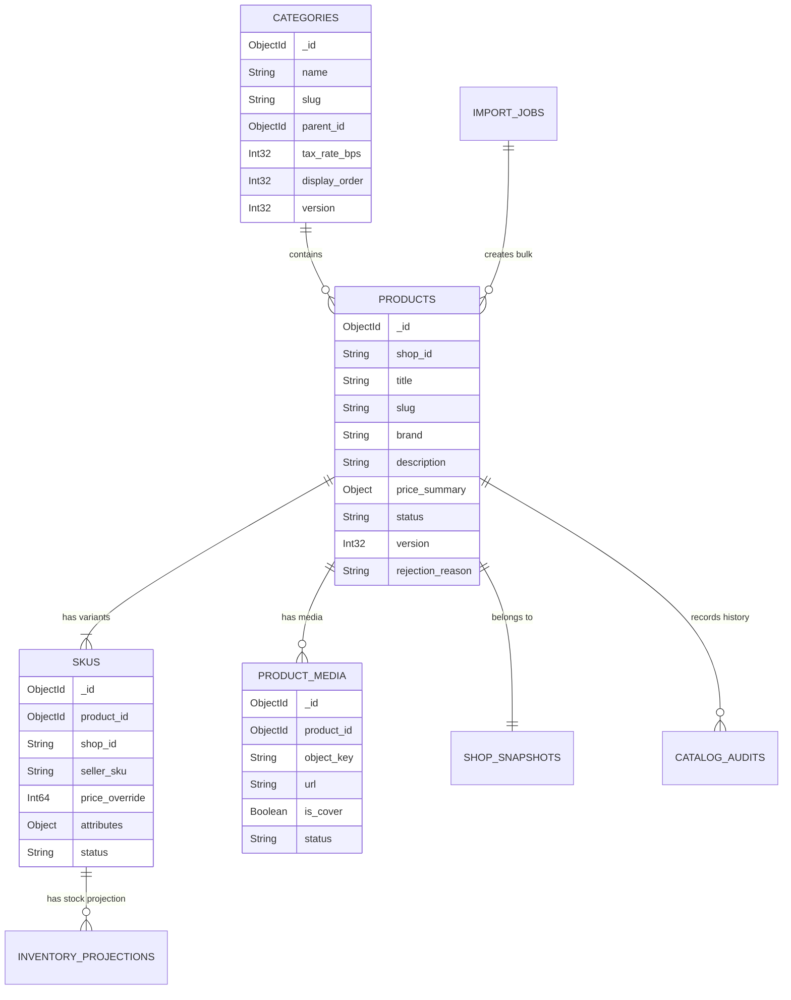
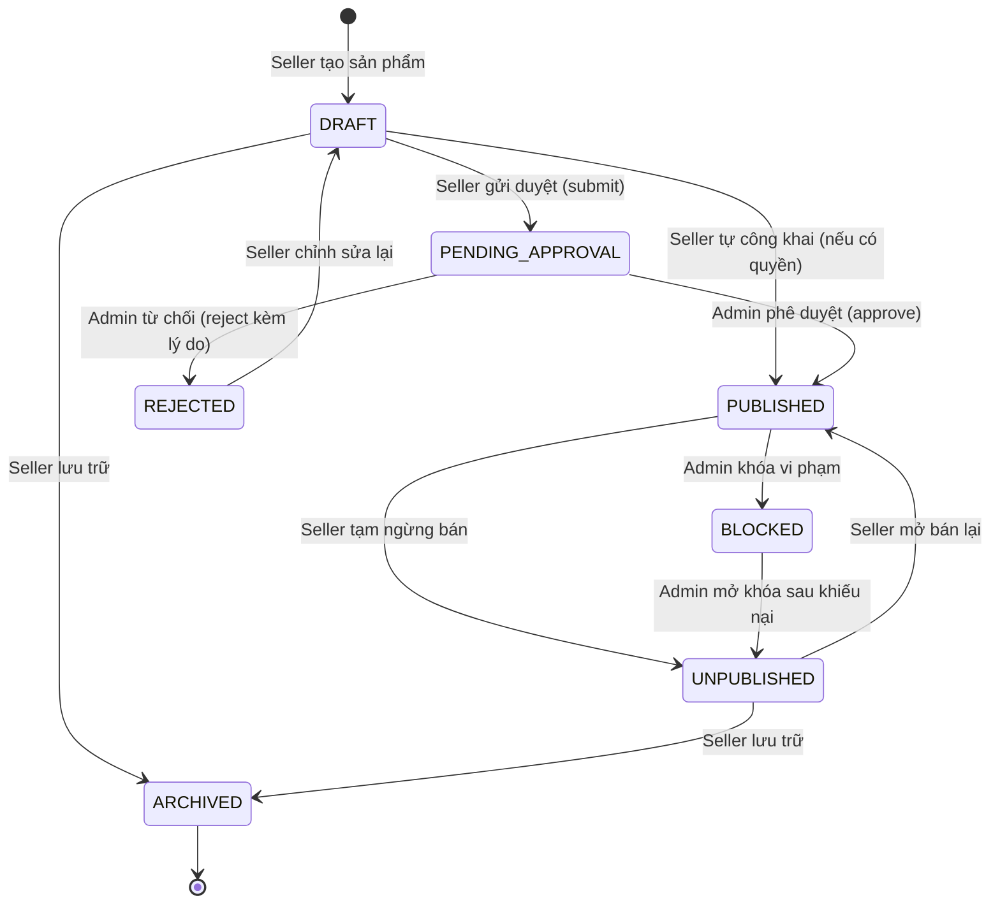

# BÁO CÁO AUDIT TOÀN DIỆN PRODUCT CATALOG – TACA ECOMMERCE
## PHẦN 03: KIỂM TOÁN TÍNH NHẤT QUÁN DỮ LIỆU VÀ SCHEMA (DATA CONSISTENCY AUDIT)

---

### 1. KIỂM TOÁN SCHEMA DATABASE VÀ CẤU TRÚC ENTITY

Backend quản lý dữ liệu danh mục sản phẩm thông qua **MongoDB Cluster** với 11 Collections/Entities chính. Dưới đây là kết quả đối chiếu giữa Mongoose Schema và Model dữ liệu Frontend tiếp nhận:



---

### 2. PHÂN TÍCH CHI TIẾT 11 COLLECTIONS VÀ MÔ HÌNH DỮ LIỆU

| Collection / Entity | Mongoose Schema (BE) | Frontend Model / Context | Mức độ tương thích | Đánh giá kỹ thuật |
| :--- | :--- | :--- | :---: | :--- |
| **`products`** | `_id`, `shop_id`, `title`, `slug`, `brand`, `description`, `price_summary: { base_price, sale_price, currency }`, `status`, `version`, `rejection_reason` | Chuyển đổi qua `normalizeProduct`: `id`, `name`, `price`, `salePrice`, `status`, `version`, `rejectionReason` | **MATCH (qua Adapter)** | Tầng Adapter đảm bảo UI tương thích ngược không bị lỗi `undefined` |
| **`skus`** | `_id`, `product_id`, `shop_id`, `seller_sku`, `barcode`, `price_override`, `attributes: Record<string, string>`, `status` | `id`, `sku`, `price`, `attributes`, `stock` (join từ projections) | **MATCH** | Attributes được map 2 chiều giữa key tiếng Anh và label tiếng Việt |
| **`categories`** | `_id`, `name`, `slug`, `parent_id`, `tax_rate_bps`, `icon_url`, `display_order`, `status`, `version` | `id`, `name`, `slug`, `parentId`, `taxRateBps`, `icon`, `displayOrder`, `version` | **MATCH** | `tax_rate_bps` tính bằng điểm cơ bản (1000 = 10%) |
| **`product_categories`** | Bảng liên kết trung gian N-N lưu `product_id`, `category_id`, `is_primary` | Không lưu trực tiếp trên FE; trả về qua `primary_category_id` và `secondary_category_ids` | **MATCH** | Phục vụ truy vấn đa danh mục hiệu năng cao trên BE |
| **`product_media`** | `_id`, `product_id`, `scope`, `object_key`, `url`, `content_type`, `size_bytes`, `sha256`, `is_cover`, `status` | `media` (danh sách object) hoặc `images` (danh sách URL string) | **MATCH (qua Adapter)** | Adapter tự động trích xuất `is_cover` làm `coverImage` |
| **`shop_snapshots`** | `shop_id`, `shop_name`, `logo_url`, `rating_summary`, `status` | `shop: { id, name, logo, rating }` | **MATCH** | Được đồng bộ từ Auth-User Service qua Kafka event `shop.updated` |
| **`inventory_projections`**| `sku_id`, `shop_id`, `available_quantity`, `reserved_quantity`, `version` | `stock` hoặc `availableQuantity` trên SKU item | **MATCH** | Đồng bộ bất đồng bộ từ Warehouse/Inventory Service |
| **`outbox_events`** | `_id`, `aggregate_type`, `aggregate_id`, `event_type`, `payload`, `status` | Bảng nội bộ Backend; Debezium CDC đọc để stream sang Kafka | **BE ONLY** | Đảm bảo tính nhất quán giao dịch (Transactional Outbox) |
| **`catalog_audits`** | `_id`, `actor_id`, `actor_role`, `action`, `entity_type`, `entity_id`, `diff`, `created_at` | Màn hình Admin Audit Logs nhận qua `GET /admin/catalog/audits` | **MATCH** | Ghi nhận bất biến (Immutable Audit Trail) |
| **`import_jobs`** | `_id`, `shop_id`, `file_name`, `status`, `total_rows`, `processed_rows`, `error_count`, `error_file_url` | Quản lý qua Modal Import và hàm `getImportJob(jobId)` | **MATCH** | Hỗ trợ polling tiến độ nhập hàng loạt |
| **`system_configs`** | `config_key`, `config_value`, `description`, `updated_at` | Cấu hình nội bộ catalog (Max SKU per product: 50, Max images: 10) | **BE ONLY** | Dùng trong ValidationPipe của Backend |

---

### 3. ĐỐI SOÁT CÁC SAI LỆCH VỀ TÊN TRƯỜNG (FIELD NAMING DISCREPANCIES)

Trong quá trình phát triển độc lập, một số quy ước đặt tên trường giữa BE và FE ban đầu có sự khác biệt. Tầng Adapter `shared/utils/adapters/product.adapter.js` đã giải quyết toàn bộ các sai lệch này:

```text
┌───────────────────────────────┬───────────────────────────────┬──────────────────────────────────────────┐
│ BACKEND NATIVE FIELD (NESTJS) │ FRONTEND NATIVE FIELD (REACT) │ XỬ LÝ CHUẨN HÓA TẠI ADAPTER              │
├───────────────────────────────┼───────────────────────────────┼──────────────────────────────────────────┤
│ product._id / product_id      │ product.id                    │ id = data.product_id || data._id || data.id│
│ product.title                 │ product.name                  │ name = data.title || data.name || ''     │
│ product.price_summary.base_price│ product.price / originalPrice │ price = data.price_summary?.base_price   │
│ product.media: [{ url, ... }] │ product.images: ['url1', ...] │ images = media.map(m => m.url)           │
│ product.media.is_cover: true  │ product.coverImage            │ coverImage = media.find(m => m.is_cover) │
│ category.tax_rate_bps         │ category.tax (0.10)           │ tax = (data.tax_rate_bps || 0) / 10000   │
│ sku.price_override            │ sku.price                     │ price = sku.price_override || base_price │
│ product.rejection_reason      │ product.rejectionReason       │ rejectionReason = data.rejection_reason  │
└───────────────────────────────┴───────────────────────────────┴──────────────────────────────────────────┘
```

---

### 4. ĐỒNG BỘ HỆ THỐNG ENUM VÀ MÁY TRẠNG THÁI (STATE MACHINES)

#### 4.1. Máy trạng thái sản phẩm (`ProductStatus`)
Backend định nghĩa enum `ProductStatus` gồm 7 trạng thái nghiêm ngặt:
```typescript
export enum ProductStatus {
  DRAFT = 'DRAFT',                       // Bản nháp đang soạn thảo bởi Seller
  PENDING_APPROVAL = 'PENDING_APPROVAL', // Đã gửi yêu cầu duyệt, chờ Admin xem xét
  PUBLISHED = 'PUBLISHED',               // Đã duyệt hoặc tự công khai, hiển thị trên Storefront
  UNPUBLISHED = 'UNPUBLISHED',           // Tạm dừng kinh doanh bởi Seller
  BLOCKED = 'BLOCKED',                   // Bị khóa bởi Admin do vi phạm chính sách
  REJECTED = 'REJECTED',                 // Bị từ chối duyệt bởi Admin, kèm rejection_reason
  ARCHIVED = 'ARCHIVED',                 // Đã lưu trữ / xóa mềm vĩnh viễn
}
```



- **Kiểm tra Frontend**:
  - `apps/seller/src/features/products/pages/ProductsPage.jsx`: Đã tích hợp đầy đủ các Tabs lọc trạng thái: `ALL`, `PUBLISHED`, `DRAFT`, `PENDING_APPROVAL`, `REJECTED`, `ARCHIVED`.
  - Hiển thị badge màu sắc trực quan tương ứng với từng trạng thái (`PUBLISHED`: xanh lá, `PENDING_APPROVAL`: vàng cam, `BLOCKED` / `REJECTED`: đỏ).
  - Khi sản phẩm bị `REJECTED`, giao diện hiển thị tooltip và alert box chứa `rejection_reason` giúp Seller biết rõ lý do để chỉnh sửa.

#### 4.2. Trạng thái Biến thể SKU (`SkuStatus`)
- Backend: `ACTIVE`, `INACTIVE`.
- Frontend: Hỗ trợ toggle bật/tắt bán từng biến thể ngay trong bảng SKU của `ProductEditorModal.jsx`.

#### 4.3. Trạng thái Tải ảnh Media (`MediaStatus`)
- Backend: `PENDING_UPLOAD` -> `COMPLETED` | `FAILED`.
- Frontend: Hiển thị thanh tiến trình tải ảnh, chỉ khi API `completeMediaUpload` thành công mới hiển thị ảnh hoàn tất trong gallery.

---

### 5. KIỂM SOÁT ĐỒNG THỜI (OPTIMISTIC CONCURRENCY CONTROL - OCC)

Backend áp dụng nguyên tắc kiểm soát đồng thời không khóa (Lock-free Optimistic Concurrency Control) trên các thực thể `Product` và `Category` bằng trường số nguyên `version`:
- Khi tạo mới: `version = 1`.
- Mỗi lần cập nhật (`PATCH /seller/products/{id}`, `PUT /categories`, `PUT /skus`, `POST /submit`, `POST /publish`):
  1. Client bắt buộc gửi trường `version: <current_version>`.
  2. Backend thực hiện truy vấn nguyên tử (Atomic Query):
     ```typescript
     const updated = await this.productModel.findOneAndUpdate(
       { _id: id, version: dto.version },
       { $set: updateFields, $inc: { version: 1 } },
       { new: true }
     );
     if (!updated) {
       throw new ConflictException({
         error_code: 'PRODUCT_VERSION_CONFLICT',
         message: 'Sản phẩm đã bị sửa đổi bởi phiên làm việc khác. Vui lòng tải lại dữ liệu.'
       });
     }
     ```
- **Xử lý trên Frontend**:
  - Modal chỉnh sửa sản phẩm (`ProductEditorModal.jsx`) lưu giữ `product.version` trong React state.
  - Khi submit payload, `version` luôn được đính kèm vào body.
  - Khi bắt gặp mã lỗi `409 Conflict`, giao diện hiển thị Toast thông báo xung đột phiên làm việc và kích hoạt hàm `fetchProduct()` để đồng bộ lại dữ liệu mới nhất mà không làm mất form nháp của người dùng.

