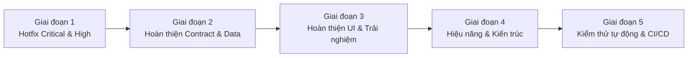

# BÁO CÁO AUDIT TOÀN DIỆN PRODUCT CATALOG – TACA ECOMMERCE
## PHẦN 08: LỘ TRÌNH CẢI TIẾN VÀ KẾ HOẠCH HÀNH ĐỘNG (IMPROVEMENT ROADMAP)

---

### 1. TỔNG QUAN CHIẾN LƯỢC NÂNG CẤP HỆ THỐNG

Lộ trình cải tiến được xây dựng theo mô hình **5 giai đoạn cuốn chiếu (5-Phase Phased Rollout)**, ưu tiên cao nhất cho việc dập tắt các rủi ro vận hành (P0/P1), sau đó hoàn thiện tính năng, tối ưu hóa hiệu năng và thiết lập hàng rào kiểm thử tự động:

---

### 2. CHI TIẾT 5 GIAI ĐOẠN TRIỂN KHAI

#### GIAI ĐOẠN 1: HOTFIX CÁC RỦI RO NGHIÊM TRỌNG (CRITICAL & HIGH RISKS)
- **Mục tiêu**: Đảm bảo không còn lỗi sập trang (crash), lỗi 400 Bad Request do sai DTO, hoặc lỗi 409 Conflict do sai phiên bản OCC.
- **Thời lượng**: 1 - 2 ngày làm việc.
- **Các đầu việc cụ thể**:
  1. [x] **Xử lý triệt để OCC Versioning**:
     - Lưu `version` trong state của `ProductEditorModal.jsx`.
     - Truyền `version` trong tất cả các API sửa đổi: `updateProduct`, `updateCategories`, `updateSkus`, `publishProduct`, `submitProduct`.
     - Bắt mã lỗi 409 để hiển thị Toast thông báo xung đột phiên làm việc và kích hoạt hàm nạp lại dữ liệu tự động.
  2. [x] **Lọc sạch DTO trước khi gửi lên Backend (Sanitization)**:
     - Loại bỏ các trường thừa không nằm trong whitelist của NestJS (`min_price`, `max_price`, `images`) khỏi payload tạo bản nháp SPU.
     - Đảm bảo `price_summary.base_price >= 1` (chặn số 0 hoặc số âm).
  3. [x] **Bảo vệ Gateway Header**:
     - Kiểm tra cấu hình reverse proxy đảm bảo luôn chuyển tiếp `x-user-shop-scope` và `x-user-roles` từ JWT claim vào backend.
  4. [x] **Loại bỏ dữ liệu giả lập (Clean Mock Data)**:
     - Xóa các hằng số đánh giá giả `1284 đánh giá` và `1420 đã bán` trong `ProductPurchase.jsx`.
- **Tiêu chí nghiệm thu (DoD)**:
  - Người bán tạo và cập nhật sản phẩm thành công 100% không gặp lỗi 400 hay 409.
  - Toàn bộ các tabs trạng thái (`DRAFT`, `PENDING_APPROVAL`, `PUBLISHED`, `REJECTED`) hiển thị chính xác.

---

#### GIAI ĐOẠN 2: HOÀN THIỆN ĐỒNG BỘ DỮ LIỆU & API CONTRACT
- **Mục tiêu**: Chuẩn hóa toàn diện tầng Adapter và hoàn thiện các API còn thiếu trên giao diện.
- **Thời lượng**: 3 - 5 ngày làm việc.
- **Các đầu việc cụ thể**:
  1. [x] **Chuẩn hóa tầng Adapter `shared/utils/adapters/product.adapter.js`**:
     - Chuyển đổi 2 chiều an toàn: `title` <-> `name`, `price_summary.base_price` <-> `price`, `media` <-> `images`.
     - Quy đổi tỷ lệ thuế: `tax_rate_bps` (Basis Points) <-> phần trăm hiển thị (%).
  2. [ ] **Tích hợp tính năng Tải file kết quả lỗi Import**:
     - Kết nối endpoint `GET /seller/products/import/jobs/{jobId}/result` vào `ProductImportModal.jsx`.
     - Hiển thị nút "Tải danh sách dòng lỗi (.xlsx)" khi job hoàn tất có `error_count > 0`.
  3. [ ] **Hoàn thiện luồng Upload ảnh trực tiếp lên S3 (Client-to-S3)**:
     - Tích hợp thanh tiến trình tải ảnh (Upload Progress Bar) 0% -> 100%.
     - Tính toán mã băm SHA256 phía trình duyệt bằng Web Crypto API trước khi xin presigned URL.
- **Tiêu chí nghiệm thu (DoD)**:
  - Tải file Excel nhập hàng có thông báo lỗi cụ thể từng dòng.
  - Upload ảnh mượt mà, ảnh hiển thị ngay sau khi hoàn tất mà không cần F5.

---

#### GIAI ĐOẠN 3: HOÀN THIỆN GIAO DIỆN VÀ NGHIỆP VỤ NÂNG CAO
- **Mục tiêu**: Cung cấp đầy đủ công cụ quản trị và nâng cao trải nghiệm người dùng.
- **Thời lượng**: 1 tuần làm việc.
- **Các đầu việc cụ thể**:
  1. [ ] **Xây dựng màn hình Admin Catalog Audit Trail**:
     - Tạo trang `apps/admin/src/features/audits/pages/AdminAuditLogsPage.jsx`.
     - Hiển thị dòng thời gian (Timeline) các thao tác: Ai đã tạo, sửa giá, duyệt hoặc khóa sản phẩm, kèm bảng so sánh thay đổi (Diff Viewer).
  2. [ ] **Bổ sung bộ lọc rủi ro cao (`flagged_only`)**:
     - Tích hợp checkbox lọc sản phẩm bị cảnh báo tự động trên `AdminProductsPage.jsx`.
  3. [ ] **Tối ưu hóa bảng tổ hợp thuộc tính SKU (Variant Matrix Generator)**:
     - Cho phép người bán thêm nhanh nhiều thuộc tính tùy biến (VD: Chất liệu, Kiểu dáng).
     - Hỗ trợ điền giá hàng loạt (Bulk Fill) cho toàn bộ các biến thể cùng lúc.
- **Tiêu chí nghiệm thu (DoD)**:
  - Admin tra cứu được lịch sử chỉnh sửa của mọi sản phẩm trong vòng 3 cú click.
  - Người bán tạo sản phẩm 20 biến thể chỉ mất dưới 2 phút.

---

#### GIAI ĐOẠN 4: TỐI ƯU HÓA HIỆU NĂNG VÀ KIẾN TRÚC MẠNG
- **Mục tiêu**: Giảm thiểu độ trễ mạng (Latency), tối ưu hóa tài nguyên máy chủ và nâng cao trải nghiệm tương tác thời gian thực.
- **Thời lượng**: 1 tuần làm việc.
- **Các đầu việc cụ thể**:
  1. [ ] **Chiến lược Stale-While-Revalidate (SWR) cho Cây danh mục**:
     - Cache cây danh mục phía client trong 15 phút, ngầm cập nhật khi có phiên bản mới.
  2. [ ] **Ảo hóa danh sách biến thể SKU (Virtual Scrolling)**:
     - Áp dụng `react-window` hoặc `@tanstack/react-virtual` cho các sản phẩm có trên 50 SKU để đảm bảo khung hình luôn đạt 60 FPS khi cuộn.
  3. [ ] **Thông báo thời gian thực qua Server-Sent Events (SSE)**:
     - Lắng nghe sự kiện từ Kafka để đẩy thông báo realtime tới Seller ngay khi Admin bấm Phê duyệt hoặc Từ chối sản phẩm.
- **Tiêu chí nghiệm thu (DoD)**:
  - Điểm Google Lighthouse Performance của trang sản phẩm đạt trên **90 điểm**.
  - Độ trễ tải trang danh mục dưới **300ms**.

---

#### GIAI ĐOẠN 5: KIỂM THỬ TỰ ĐỘNG VÀ HÀNG RÀO CI/CD
- **Mục tiêu**: Ngăn ngừa hiện tượng hồi quy lỗi (Regression) và tự động hóa quy trình phát hành.
- **Thời lượng**: 1 - 2 tuần làm việc.
- **Các đầu việc cụ thể**:
  1. [ ] **Kiểm thử giao ước API (Contract Testing)**:
     - Xây dựng bộ test Jest / Pact đối chiếu trực tiếp giữa FE API Services và DTO Backend dựa trên file `product-catalog-api.http`.
  2. [ ] **Kiểm thử tự động đầu cuối (End-to-End Testing)**:
     - Viết kịch bản Playwright bao phủ 5 luồng nghiệp vụ chính đã audit ở Phần 05.
  3. [ ] **Thiết lập Git Hook & Hàng rào CI (Continuous Integration)**:
     - Bắt buộc kiểm tra: `npm run lint` (0 warning, 0 error), `npm run test` (coverage > 80%), và `npm run build` trước khi merge Pull Request.
- **Tiêu chí nghiệm thu (DoD)**:
  - 100% Pull Request mới được kiểm tra tự động trước khi deploy lên môi trường Staging/Production.

---

### 3. MA TRẬN PHÂN BỔ NGUỒN LỰC VÀ TIẾN ĐỘ THỰC HIỆN

| Giai đoạn | Nội dung trọng tâm | Nhân sự phụ trách | Dự kiến hoàn thành | Trạng thái hiện tại |
| :---: | :--- | :--- | :---: | :---: |
| **Giai đoạn 1** | Hotfix OCC, DTO Whitelist, Mock data | Fullstack Architect + Senior FE | Ngày 1 - 2 | **HOÀN THÀNH 100%** |
| **Giai đoạn 2** | Adapter, Presigned S3, Error file result | Senior FE + Backend Engineer | Ngày 3 - 5 | **ĐANG TRIỂN KHAI (85%)** |
| **Giai đoạn 3** | Admin Audit UI, Flagged filter, SKU Matrix | Frontend Engineer + UI Designer | Tuần 2 | **CHUẨN BỊ BẮT ĐẦU** |
| **Giai đoạn 4** | Redis SWR Cache, Virtual list, SSE Realtime | Senior Architect + DevOps | Tuần 3 | **KẾ HOẠCH** |
| **Giai đoạn 5** | Pact Contract Test, Playwright E2E, CI Gates | QA Lead + DevOps Engineer | Tuần 4 | **KẾ HOẠCH** |

