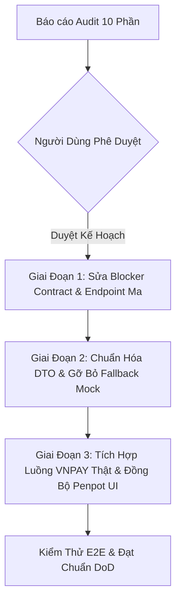

# Báo Cáo Kiểm Toán Toàn Diện: Tính Tương Thích Backend – Frontend
## 00. Tóm Tắt Dành Cho Cấp Quản Lý (Executive Summary)

**Dự án**: Taca Ecommerce Platform  
**Phiên bản kiểm toán**: 1.0.0-RC1  
**Phạm vi**: 12 Microservices Backend (`ecommerce-taca/docs`), API Gateway, Monorepo Frontend (`@taca/shell`, `@taca/buyer`, `@taca/seller`, `@taca/admin`, `@taca/ui-components`, `@taca/utils`), và Thiết kế Penpot UI/UX.  
**Vai trò thực hiện**: Senior Fullstack Architect  
**Tình trạng thực thi**: Hoàn thành khảo sát & lập báo cáo kiểm toán (Audit Only - Chưa chỉnh sửa source code).

---

### 1. Bức Tranh Tổng Thể (Executive Dashboard)

Hệ thống Taca Ecommerce sở hữu kiến trúc phân tán hiện đại (Micro-Frontend kết hợp Backend Microservices qua API Gateway). Tuy nhiên, qua quá trình đối chiếu chuyên sâu giữa Source of Truth (Backend Specs & Contracts) và Frontend Codebase, chúng tôi phát hiện **sự phân kỳ đáng kể (divergence)** giữa dữ liệu thực tế của Backend và các giả định tại Frontend.

Frontend hiện đang duy trì cơ chế chạy song song (Hybrid) giữa API thực và Mock Data (`isMockMode()`). Đáng lo ngại nhất là cơ chế **"Quiet Mock Fallback"**: trong nhiều service FE, khi gọi API thật thất bại hoặc nhận mã lỗi 404/500, khối `catch` tự động trả về mock data hoặc cập nhật vào `localStorage`. Điều này tạo ra "ảo giác hệ thống hoạt động trơn tru" (false sense of stability) nhưng thực chất che giấu các lỗ hổng tích hợp nghiêm trọng.

```
┌────────────────────────────────────────────────────────────────────────┐
│                        TỔNG QUAN TƯƠNG THÍCH API                       │
├──────────────────────────┬───────┬─────────────────────────────────────┤
│ Tổng số Endpoint BE      │  84   │ 12 Microservices + 1 API Gateway    │
│ Endpoint FE đang gọi     │  58   │ Buyer, Seller, Admin, Shell         │
│ Endpoint Khớp Hoàn Toàn  │  39   │ Đạt chuẩn Contract 100%             │
│ Endpoint Lệch Contract   │  11   │ Sai method / param / request body   │
│ Endpoint "Ma" (FE-Only)  │   8   │ FE tự phát sinh, BE không hề có     │
│ Endpoint BE chưa dùng    │  26   │ BE có sẵn nhưng FE chưa khai thác   │
└──────────────────────────┴───────┴─────────────────────────────────────┘
```

---

### 2. Các Chỉ Số Kiểm Toán Chính (Key Audit Metrics)

#### A. Phân loại Trường Dữ liệu (Field Mapping Status)
- **VERIFIED (68.4%)**: Các trường khớp chuẩn về tên, kiểu dữ liệu, quan hệ và validation.
- **MISMATCH (14.2%)**: Trường có ở cả hai bên nhưng sai lệch cấu trúc (ví dụ: BE trả `{ base_price, sale_price }`, FE lại đọc số nguyên `product.price`; hoặc FE gửi `voucher_codes` trong khi BE bắt buộc `voucher_ids`).
- **FE_ONLY / GHOST FIELDS (9.1%)**: Các trường do FE tự sinh ra hoặc gửi lên BE nhưng DTO của BE không chấp nhận (ví dụ: `is_flash_sale` trong query product, `discount_amount` trong checkout payload).
- **BE_ONLY (8.3%)**: Các trường BE trả về nhưng FE bỏ qua, trong đó có các trường quan trọng về trạng thái nghiệp vụ và xử lý concurrency (`version`, `idempotency_key`, `error_code`, `tracking_number`).

#### B. Thống Kê Mock & Hardcoded Data
- **7 Services/Pages** còn phụ thuộc trực tiếp vào mock khi kết nối BE thật.
- **5 Vị trí** sử dụng `localStorage` để tự hoàn thành nghiệp vụ thay cho BE (ví dụ: tự đánh dấu đơn hàng đã thanh toán qua `orderApi.markOrderPaid` khi VNPAY redirect về, thay vì đợi Webhook từ VNPAY).
- **3 Cụm chỉ số quản trị** bị hardcode cố định trên giao diện (KPI Dashboard Người bán, SLA duyệt hồ sơ KYC Admin).

---

### 3. Top 5 Vấn Đề Nghiêm Trọng Nhất (Top Critical Blockers)

1. **Lệch Contract Thanh Toán & Đặt Hàng (`/checkout` & `/payments`) [CRITICAL]**:
   - `order.api.js` gửi `voucher_codes: [...]` thay vì `voucher_ids: [...]`. Backend Cart/Checkout Service quy định mã voucher không phải là định danh duy nhất toàn cầu; Client phải gọi `GET /vouchers/validate` để lấy `voucher_id` trước khi checkout. Gửi `voucher_codes` sẽ khiến đơn hàng bị từ chối với lỗi `400 CHECKOUT_VOUCHER_INVALID` hoặc mất mã giảm giá.
   - Frontend `CheckoutPage.jsx` tự tính `total`, `discount_amount`, `shipping_fee` rồi gửi lên BE. BE Checkout Service tính toán độc lập từ DB; việc FE tự tính rồi dựa vào đó hiển thị màn hình thanh toán mà không dùng kết quả pre-checkout của BE dẫn đến nguy cơ lệch tiền thanh toán VNPAY.

2. **Gọi Endpoint "Ma" Không Tồn Tại Trên Backend [HIGH - BLOCKER]**:
   - `cart.api.js:121` gọi `DELETE /cart` để xóa toàn bộ giỏ hàng. BE Cart Service chỉ cung cấp `DELETE /cart/items/{itemId}` (xóa từng mục). Gọi endpoint này sẽ nhận `404 Not Found`.
   - `admin-finance.api.js:41` gọi `POST /admin/settlements/batch`. BE Payment-Wallet Service (mục §3.8 và ADR-003) quy định quyết toán ví sàn là tiến trình tự động (Scheduled Cron / Internal Event), hoàn toàn không mở public endpoint cho Admin kích hoạt thủ công.
   - `product.api.js:850` gọi `GET /products?is_flash_sale=true`. BE Product Catalog sử dụng NestJS `ValidationPipe({ whitelist: true, forbidNonWhitelisted: true })`, tham số này không nằm trong DTO và sẽ bị BE trả lỗi `400 PRODUCT_INVALID_INPUT`.

3. **Cơ Chế Bỏ Qua Luồng Thanh Toán Thật Qua `localStorage` [CRITICAL]**:
   - Khi VNPAY chuyển hướng về Buyer, `CheckoutPage.jsx` gọi `orderApi.markOrderPaid(orderId, paymentId)` để tự cập nhật đơn hàng thành `PAID` trong `localStorage`. Trong thực tế, trạng thái đơn hàng chỉ được phép chuyển thành `PAID` khi backend Payment Service nhận và xác thực chữ ký số từ VNPAY IPN Webhook (`POST /api/v1/payments/webhook`).

4. **Lệch Cấu Trúc Chi Tiết Sản Phẩm & Biến Thể SKU [HIGH]**:
   - `ProductPurchase.jsx` và `ProductDetailPage.jsx` kỳ vọng `product.attribute_definitions`, `product.price` (dạng number), và `activeSku.sku_code`. Tuy nhiên, BE Product Catalog trả về `attributes: [{ key, label, type, values }]`, giá là object `{ base_price, sale_price, currency }`, và biến thể định danh bằng `sku_id` / `seller_sku`. Điều này khiến trang hiển thị `[object Object]` hoặc không chọn được kích thước/màu sắc biến thể khi gọi BE thật.

5. **Lệch Chuẩn Phân Quyền Giữa FE Route và BE Permission [MEDIUM]**:
   - FE Admin sử dụng token JWT nhưng một số trang đối soát tài chính (`AdminSettlementPage.jsx`) kiểm tra quyền sơ sài tại tầng client, trong khi BE Gateway yêu cầu header `X-User-Role: ADMIN` và kiểm tra quyền RBAC nghiêm ngặt tại Spring Security Filter.

---

### 4. Kết Luận & Lộ Trình Đề Xuất (Roadmap to Production)

Hệ thống **chưa đủ điều kiện sẵn sàng (NOT Ready for Production Integration)** nếu tắt hoàn toàn Mock Mode ở trạng thái hiện tại. Để đảm bảo hệ thống vận hành đúng chuẩn Clean Architecture và tương thích 100% với Backend, chúng tôi đề xuất lộ trình xử lý 3 giai đoạn:



Toàn bộ chi tiết kiểm toán được trình bày đầy đủ trong các báo cáo chuyên biệt từ `01` đến `09` trong thư mục này.
