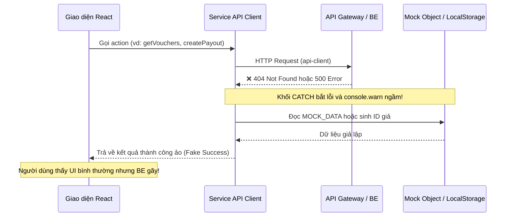

# Báo Cáo Kiểm Toán Toàn Diện: Tính Tương Thích Backend – Frontend
## 06. Rà Soát Dữ Liệu Giả Lập & Hardcode (Mock & Hardcoded Data Audit)

**Mục tiêu**: Bóc tách toàn bộ các vị trí còn tồn tại dữ liệu mock, hardcode, dữ liệu giả định và các khối `catch` che giấu lỗi tích hợp (Quiet Mock Fallbacks).

---

### 1. Hiện Tượng "Quiet Mock Fallback" (Cơ Chế Bẫy Lỗi Trả Mock)

Đây là vấn đề kỹ thuật nguy hiểm nhất trong mã nguồn hiện tại: khi cờ `isMockMode()` được tắt (chạy với Backend thật), nếu API Gateway trả về lỗi (404, 500, network error), các service Frontend lập tức rơi vào khối `catch` và âm thầm trả về mock data hoặc cập nhật `localStorage`. Điều này khiến Developer và Tester tưởng rằng tính năng đã tích hợp thành công, trong khi thực tế Backend chưa xử lý được.

---

### 2. Bảng Danh Mục Chi Tiết Vị Trí Mock & Hardcode Toàn Dự Án

| STT | File / Đường Dẫn | Vị Trí Dòng | Bản Chất Vấn Đề | Hậu Quả Kỹ Thuật | Hành Động Yêu Cầu |
|:---|:---|:---|:---|:---|:---|
| 1 | `apps/seller/.../DashboardPage.jsx` | Dòng 26 | `const [metrics, setMetrics] = useState(SELLER_MOCK_DATA.dashboard);` | Các chỉ số doanh thu (124.5M), số đơn (48), tỷ lệ chuyển đổi (3.8%) là số chết, không bao giờ cập nhật theo đơn bán thật. | Chuyển sang gọi song song `GET /seller/wallet/balance` và `GET /seller/orders` để tính chỉ số thật. |
| 2 | `apps/admin/.../AdminKycPage.jsx` | Dòng 9–18 | `const [metrics, setMetrics] = useState({ pending_count: 284, approved_count: 1240, ... })` | Các con số thống kê hàng chờ duyệt và SLA thẩm định (`3h 24m`) là chuỗi hardcode cố định. | Tính toán từ mảng hồ sơ thực tế trả về từ `GET /admin/shops/kyc` hoặc hiển thị badge động. |
| 3 | `apps/buyer/.../voucher.api.js` | Dòng 134 | `catch (error) { return MOCK_VOUCHERS; }` | Khi Gateway lỗi hoặc chưa có voucher nào, FE tự hiển thị danh sách voucher mẫu. | Ném lỗi (`throw error`) để UI hiển thị Empty State hoặc thông báo lỗi kết nối. |
| 4 | `apps/buyer/.../review.api.js` | Dòng 105 | `catch (error) { return MOCK_REVIEWS; }` | Khi sản phẩm mới chưa có đánh giá hoặc API lỗi, FE trả về 5 bình luận giả định. | Trả về mảng rỗng `[]` và hiển thị "Chưa có đánh giá nào cho sản phẩm này". |
| 5 | `apps/seller/.../seller-finance.api.js` | Dòng 118 | `catch (err) { return { success: true, payout_id: 'payout-' + Date.now() }; }` | Tự sinh mã `payout-` giả kèm trạng thái thành công khi BE Payment Service đang tạm khóa cổng rút tiền. | Báo lỗi rõ ràng: "Tính năng rút tiền đang trong giai đoạn thử nghiệm đối soát". |
| 6 | `apps/seller/.../seller-finance.api.js` | Dòng 152 | `catch (err) { return MOCK_PAYOUTS; }` | Lịch sử rút tiền hiển thị danh sách mock khi BE chưa có dữ liệu. | Hiển thị bảng trống kèm thông báo chuẩn. |
| 7 | `apps/seller/.../seller-finance.api.js` | Dòng 180 | `catch (err) { return { download_url: '...' }; }` | Trả về link tải giả định cho báo cáo doanh thu Excel. | Báo lỗi hoặc ẩn nút export khi BE chưa có controller xuất file. |
| 8 | `apps/buyer/.../order.api.js` | Dòng 308 | `catch (error) { return getLocalOrders(); }` | Khi mất mạng hoặc API lỗi, tự đọc đơn từ `localStorage` tạo cảm giác đơn vẫn tồn tại. | Phân định rõ trạng thái offline và online; ném lỗi khi ở chế độ live. |
| 9 | `apps/buyer/.../order.api.js` | Dòng 322 | `markOrderPaid: async (orderId, paymentId)` | Tự cập nhật trạng thái đơn thành `PAID` trong `localStorage` thay vì kiểm tra trạng thái trên BE. | Xóa bỏ hàm này; kiểm tra trạng thái qua polling hoặc websocket/SSE từ BE. |
| 10| `apps/buyer/.../CheckoutPage.jsx` | Dòng 64 | `MOCK_SHIPPING_PROVIDERS = [...]` | Hardcode danh sách ĐVVC (GHN 30k, GHTK 35k) thay vì lấy theo địa chỉ giao hàng thực tế. | Gọi `POST /checkout/preview` hoặc API tính cước vận chuyển của BE. |
| 11| `apps/buyer/.../favorites.api.js` | Dòng 1–80 | Toàn bộ service lưu trữ cục bộ qua `localStorage` (`favorite_products_v1`) | Không đồng bộ danh sách yêu thích lên tài khoản người dùng khi chuyển thiết bị. | Đánh dấu là tính năng Local-only hoặc bổ sung API Wishlist vào BE nếu có nhu cầu. |

---

### 3. Nguyên Tắc Xử Lý Chuẩn Kiến Trúc Clean Architecture

1. **Tuyệt đối không dùng Mock ngầm trong Production**:
   - Nếu `VITE_USE_MOCK_API === 'false'`, mọi cuộc gọi thất bại phải được truyền ra ngoài để UI hiển thị màn hình Error State kèm nút "Thử lại" (Retry).
2. **Không tự sinh dữ liệu trạng thái nghiệp vụ (No Client-Generated Business State)**:
   - Các trạng thái quan trọng như: `order_id`, `payout_id`, trạng thái thanh toán `PAID`, số dư ví `available_balance` **bắt buộc** phải có nguồn gốc từ cơ sở dữ liệu Backend thông qua phản hồi HTTP.
3. **Phân định rõ UI State và Server State**:
   - Chỉ lưu trong `localStorage` các thông tin thuộc về tùy biến người dùng (theme Dark/Light, ngôn ngữ, sản phẩm đã xem gần đây, giỏ hàng vãng lai trước khi đăng nhập).
