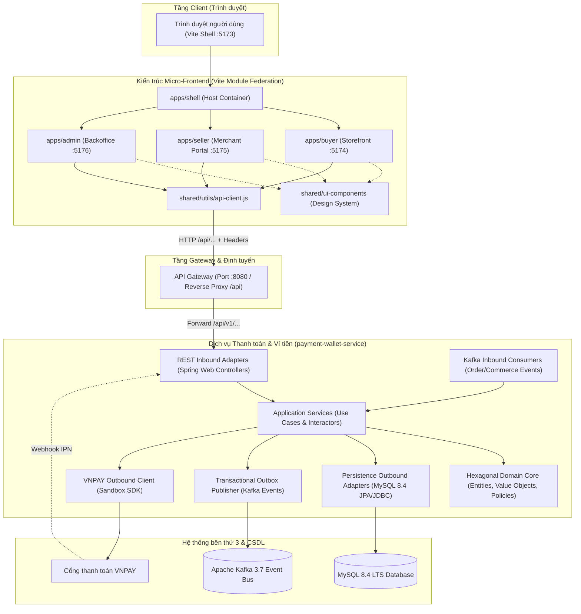

# CHƯƠNG 1: KIỂM TOÁN KIẾN TRÚC HỆ THỐNG (SYSTEM ARCHITECTURE AUDIT)
## KIẾN TRÚC HEXAGONAL BACKEND VÀ MONOREPO MICRO-FRONTEND

---

## 1. TỔNG THỂ KIẾN TRÚC HỆ THỐNG

Hệ thống sàn thương mại điện tử Taca Ecommerce được xây dựng theo mô hình phân tán (Distributed Microservices) ở tầng Backend và Kiến trúc Đa giao diện vi mô (Monorepo Micro-Frontend) ở tầng Frontend.



---

## 2. PHÂN TÍCH KIẾN TRÚC BACKEND: HEXAGONAL ARCHITECTURE (PORTS & ADAPTERS)

Backend repository `payment-wallet-service` (Java 25, Spring Boot 4) áp dụng nghiêm ngặt mẫu thiết kế **Hexagonal Architecture (Ports and Adapters)** kết hợp **Domain-Driven Design (DDD)**. Mã nguồn được phân chia thành các package độc lập theo đúng nguyên lý Dependency Inversion.

### 2.1. Cấu trúc cây thư mục Backend thực tế
```text
payment-wallet-service/
├── docs/                               # Tài liệu thiết kế & ADRs
│   ├── adr/
│   │   ├── ADR-001-double-entry-ledger-immutable.md
│   │   ├── ADR-002-transactional-outbox-kafka.md
│   │   ├── ADR-003-payout-eligibility-phase-gating.md
│   │   └── ADR-004-vn-tax-withholding-circular-40.md
│   ├── api/payment-wallet-api.md
│   └── db/payment-wallet-db.md
├── src/main/java/com/taca/paymentwallet/
│   ├── domain/                         # DOMAIN CORE (Zero framework dependency)
│   │   ├── model/                      # Payment, Wallet, LedgerAccount, SettlementBatch
│   │   ├── vo/                         # Money (VND BigInt), PaymentStatus, TransactionType
│   │   └── policy/                     # FeeCalculationPolicy, TaxWithholdingPolicy, ActorShopPolicy
│   ├── application/                    # APPLICATION CORE (Use cases & Ports)
│   │   ├── port/
│   │   │   ├── in/                     # Inbound Ports (CreatePaymentCommand, SettleBatchCommand)
│   │   │   └── out/                    # Outbound Ports (PaymentRepositoryPort, OutboxPort)
│   │   └── usecase/                    # Use Case Implementations
│   ├── adapter/                        # ADAPTERS (Framework & External Drivers)
│   │   ├── in/
│   │   │   ├── web/                    # Spring MVC REST Controllers
│   │   │   │   ├── PaymentController.java
│   │   │   │   ├── SellerWalletController.java
│   │   │   │   ├── SellerLedgerController.java
│   │   │   │   ├── SellerRevenueController.java
│   │   │   │   ├── AdminPaymentReconciliationController.java
│   │   │   │   ├── AdminFeeController.java
│   │   │   │   ├── AdminTaxController.java
│   │   │   │   ├── AdminSettlementController.java
│   │   │   │   └── AdminFinanceSummaryController.java
│   │   │   └── kafka/                  # Inbound Kafka Listeners
│   │   └── out/
│   │       ├── persistence/            # Spring Data JPA Entities & Repositories
│   │       ├── kafka/                  # Kafka Event Outbox Publisher
│   │       └── vnpay/                  # VNPAY Gateway Client Implementation
│   └── infrastructure/                 # Security, Configs, Actuator, Flyway Runner
└── src/main/resources/
    ├── db/migration/                   # 18 Flyway Migration Scripts (V001 - V018)
    └── application.yml
```

### 2.2. Điểm mạnh kiến trúc Backend (Strengths)
1. **Tính bất biến của sổ cái kế toán (Double-Entry Ledger - ADR-001)**:
   - Toàn bộ giao dịch cộng trừ tiền không cập nhật trực tiếp vào số dư đơn thuần mà ghi nhận qua bảng `ledger_postings` và `ledger_entries`.
   - Mỗi bút toán bắt buộc phải cân bằng giữa `DEBIT` (Ghi nợ) và `CREDIT` (Ghi có). Tổng số tiền nợ bằng tổng số tiền có tại mọi thời điểm.
2. **Đảm bảo tính nhất quán cuối cùng bằng Transactional Outbox (ADR-002)**:
   - Các sự kiện miền (Domain Events) như `PaymentSuccessEvent`, `WalletSettledEvent` được ghi vào bảng `outbox_messages` trong cùng một Database Transaction ACID với dữ liệu nghiệp vụ.
   - Luồng nền `OutboxPollingScheduler` quét bảng này và đẩy lên Apache Kafka, triệt tiêu hoàn toàn rủi ro Dual-Write Failure (Lưu DB thành công nhưng push Kafka thất bại).
3. **Quy tắc tiền tệ chuẩn mực (Money Value Object)**:
   - Tuyệt đối không dùng kiểu dữ liệu số thực (`float`, `double`) để lưu tiền. 100% số tiền được biểu diễn bằng `Long` / `BIGINT` với đơn vị VND nguyên tệ, loại bỏ sai số dấu phẩy động.
4. **Cơ chế Idempotency chống trùng lặp giao dịch**:
   - Sử dụng bảng `idempotency_keys` lưu trữ hash request, lock state và response snapshot để đảm bảo các yêu cầu thanh toán hay rút tiền bị gửi trùng lặp (do mạng chập chờn) chỉ được xử lý đúng 1 lần duy nhất.

### 2.3. Rủi ro & Điểm nghẽn kiến trúc Backend (Weaknesses & Bottlenecks)
1. **Thiết kế Gating cứng (ADR-003) gây đứt gãy luồng người dùng**:
   - ADR-003 quy định khóa nghiệp vụ rút tiền (`RequestPayoutUseCase`) trong Phase 1. Tuy nhiên, việc không cung cấp Mock Controller hoặc Stub API khiến tầng Frontend khi kết nối thật bị vỡ luồng do nhận mã lỗi `404 Not Found`.
2. **Thiếu API quản trị kích hoạt quyết toán thủ công theo yêu cầu (On-Demand Settlement)**:
   - Backend phó mặc hoàn toàn cho Cron Job tự động (`ScheduledSettlementJob`). Khi xảy ra sự cố cần đối soát gấp hoặc thanh toán ngoài giờ, quản trị viên không có API để kích hoạt một batch mới, dẫn đến việc Admin FE phải giả lập tính năng này ở mock mode.
3. **Chưa triển khai luồng Controller xuất báo cáo Seller (`/seller/revenue/export`)**:
   - Mặc dù tài liệu API spec mô tả đầy đủ, Controller chưa viết hàm này, dẫn đến sai lệch giữa tài liệu kiến trúc và code thực tế.

---

## 3. PHÂN TÍCH KIẾN TRÚC FRONTEND: MONOREPO MICRO-FRONTEND

Frontend `taca_ecommerce` áp dụng mô hình **Monorepo Workspaces (NPM Workspaces)** kết hợp **Module Federation (Vite 5)**.

### 3.1. Phân chia ranh giới các ứng dụng (Application Boundaries)
1. **Shell Container (`apps/shell` - Port 5173)**:
   - Đóng vai trò Host Application, điều phối routing toàn cục:
     - `/` và `/*` ➔ Tải remote `apps/buyer`.
     - `/seller/*` ➔ Tải remote `apps/seller`.
     - `/admin/*` ➔ Tải remote `apps/admin`.
   - Cung cấp cơ chế **Remote Crash Protection (Error Boundary)**: Nếu remote Admin hoặc Seller bị lỗi mạng hoặc crash runtime, Shell hiển thị màn hình fallback thân thiện mà không làm sập toàn bộ trình duyệt của người dùng.
2. **Buyer Remote (`apps/buyer` - Port 5174)**:
   - Phân hệ Cửa hàng dành cho người mua: Duyệt sản phẩm, Giỏ hàng, Đặt hàng và Thanh toán VNPAY QR.
   - Độc lập hoàn toàn về state với Seller và Admin.
3. **Seller Remote (`apps/seller` - Port 5175)**:
   - Phân hệ Kênh người bán: Quản lý sản phẩm, Quản lý kho, Quản lý Voucher và Quản lý Tài chính / Ví tiền (`FinancePage.jsx`).
4. **Admin Remote (`apps/admin` - Port 5176)**:
   - Phân hệ Quản trị sàn: Phê duyệt người bán (KYC), Quản lý biểu phí / thuế (`AdminFeesTaxesPage.jsx`), Quản lý Đối soát & Quyết toán (`AdminFinancePage.jsx`).
5. **Shared UI Components (`shared/ui-components`)**:
   - Chứa các thành phần UI dùng chung: `Modal`, `Button`, `Input`, `Badge`, `Card`, `Table`.
   - **Zero-logic**: Không chứa bất kỳ lời gọi API nào, chỉ nhận props và phát sự kiện qua callbacks. 100% component có khai báo `PropTypes`.
6. **Shared Utilities & API Client (`shared/utils/api-client.js`)**:
   - Cấu hình Axios instance tập trung với Base URL `/api`.
   - Quản lý chế độ kép: `isMockMode()` đọc cờ `import.meta.env.VITE_USE_MOCK`.
   - Tự động gắn header xác thực JWT token và phân giải envelope chuẩn `{ data, meta }`.

### 3.2. Đánh giá chất lượng Module Federation & MFE Coupling
- **Độc lập triển khai (Independent Deployability)**: Mỗi remote có file cấu hình `vite.config.js` riêng biệt và có thể build độc lập (`npm run build:remotes`).
- **Chia sẻ thư viện (Shared Dependencies)**:
  - `react`, `react-dom`, `react-router-dom` được khai báo là shared dependencies singleton trong Module Federation, tránh việc tải trùng lặp React Core vào bộ nhớ trình duyệt.
- **Rủi ro Coupling về UI Tokens**:
  - Các remote sử dụng chung Tailwind preset từ root. Khi thay đổi token màu tại root, toàn bộ 3 remote tự động cập nhật đồng bộ, đảm bảo tính nhất quán thị giác tuyệt đối theo Penpot.

---

## 4. TẦNG API GATEWAY & RÀNG BUỘC MẠNG BẢO MẬT

Hệ thống tuân thủ nguyên tắc: **Frontend không bao giờ được phép gọi trực tiếp các port dịch vụ nội bộ của Microservices**.

```text
Trình duyệt Client
       │
       ▼ (Port 5173 / HTTP)
Reverse Proxy (/api)
       │
       ▼ (Port 8080 - Spring Cloud Gateway)
Tầng lọc bảo mật Gateway Filter:
  ├── Kiểm tra JWT Token & Trích xuất Identity
  ├── Gắn Header định danh Actor:
  │     ├── X-User-ID: {userId}
  │     ├── X-User-Roles: [BUYER | SELLER | ADMIN]
  │     ├── X-User-Permissions: [FINANCE_OPS | ...]
  │     └── X-User-Shop-Scope: {shopId}
  ├── Gắn Header truy vết phân tán:
  │     └── X-Request-ID: {uuid}
  └── Chuyển tiếp Header Idempotency & MFA:
        ├── Idempotency-Key: {clientGeneratedUuid}
        └── X-MFA-Step-Up: {otpToken}
       │
       ▼ (Mạng nội bộ Docker / Kubernetes)
payment-wallet-service (Internal Port 8084)
```

### Đánh giá chính sách bảo mật Gateway:
1. **Actor Scoping Injection**: Backend `payment-wallet-service` không tự xác thực mật khẩu mà tin tưởng vào các header do Gateway inject (`X-User-Shop-Scope`, `X-User-Roles`).
2. **Shop Isolation Enforcement**: Khi Người bán gọi `GET /api/v1/seller/wallet`, backend kiểm tra header `X-User-Shop-Scope` và chỉ truy vấn ví thuộc shop của người đó. Người bán A tuyệt đối không thể xem ví của Người bán B dù biết `shop_id`.
3. **Cơ chế Internal Calling**: Đối với endpoint khởi tạo thanh toán `POST /api/v1/payments`, backend chặn mọi request không có header nội bộ chứng minh đến từ `order-commerce-service`.

---

## 5. KẾT LUẬN KIỂM TOÁN KIẾN TRÚC

| Tiêu chuẩn kiến trúc | Mức độ đạt | Ghi chú & Đánh giá |
| :--- | :---: | :--- |
| **Separation of Concerns (SoC)** | 9.5 / 10 | Phân tầng rõ ràng giữa UI, Service, Adapter và Domain. |
| **Domain-Driven Design (DDD)** | 9.0 / 10 | Mô hình thực thể kế toán và thanh toán rất chặt chẽ. |
| **Micro-Frontend Isolation** | 8.8 / 10 | Tách biệt ranh giới giữa Buyer, Seller, Admin tốt; Shell có error boundary bảo vệ. |
| **Resilience & Fault Tolerance** | 8.5 / 10 | Transactional Outbox chống mất mát sự kiện Kafka; Idempotency chống double charge. |
| **Contract Consistency** | 6.5 / 10 | Xuất hiện khoảng hở giữa BE Gating và FE Implementation tại nghiệp vụ Payout & Settlement. |

