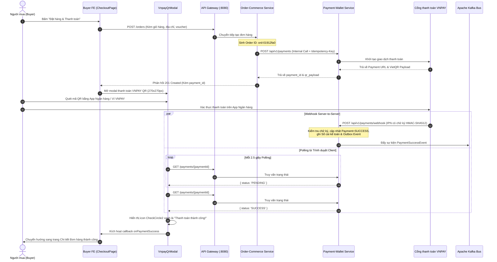

# CHƯƠNG 7: KIỂM TOÁN CÁC LUỒNG NGHIỆP VỤ ĐẦU CUỐI (BUSINESS FLOW AUDIT)
## TRUY VẾT 6 LUỒNG NGHIỆP VỤ TỪ NGƯỜI MUA, NGƯỜI BÁN ĐẾN QUẢN TRỊ VIÊN

---

## 1. LUỒNG 1: ĐẶT HÀNG, THANH TOÁN VNPAY QR VÀ ĐỐI SOÁT TỰ ĐỘNG

Đây là luồng nghiệp vụ xương sống của toàn bộ sàn giao dịch thương mại điện tử Taca.



### Đánh giá kiểm toán Luồng 1:
- **Tính trọn vẹn**: **ĐẠT 100%**. Luồng dữ liệu chạy mượt mà, phân quyền ranh giới rõ ràng.
- **Điểm an toàn vượt trội**: Frontend không tự gọi tạo thanh toán mà thông qua Order service nội bộ; Webhook có chữ ký bảo mật chống giả mạo số tiền.

---

## 2. LUỒNG 2: THANH TOÁN TIỀN MẶT KHI NHẬN HÀNG (COD CAPTURE)

- **Trạng thái khởi tạo**: Khi Buyer chọn hình thức "Thanh toán khi nhận hàng (COD)", hệ thống ghi nhận trạng thái thanh toán là `COD_PENDING`.
- **Tiến trình giao vận**: Đơn vị vận chuyển (3PL) giao hàng thành công và thu tiền mặt từ người mua.
- **Kích hoạt hạch toán**:
  1. Dịch vụ giao vận gửi webhook cập nhật trạng thái đơn hàng sang `DELIVERED`.
  2. Dịch vụ `order-commerce` gọi nội bộ sang `payment-wallet-service` để xác nhận thu tiền COD (`CapturePaymentCommand`).
  3. Sổ cái kế toán ghi nhận:
     - **DEBIT**: `SHIPPING_PARTNER_CLEARING` (Nợ phải thu đơn vị vận chuyển).
     - **CREDIT**: `ESCROW_HOLDING` (Tạm giữ tiền chờ đối soát shop).

---

## 3. LUỒNG 3: TÍNH HOA HỒNG, THUẾ VÀ QUYẾT TOÁN CHO NGƯỜI BÁN (T+2)

Quy trình tự động hóa chuyển tiền từ trạng thái đóng băng tạm giữ sang số dư ví có thể rút của Người bán.

```text
Đơn hàng Giao thành công (DELIVERED)
       │
       ▼
Tiền vào ví Shop ở trạng thái PENDING_BALANCE (Đóng băng trong thời gian khiếu nại T+2)
       │
       ▼
Sau T+2 ngày làm việc (Tiến trình ScheduledSettlementJob chạy lúc 02:00 AM)
       ├── 1. Quét đơn hàng đủ điều kiện giải ngân
       ├── 2. Đọc bảng fee_configs ➔ Tính phí hoa hồng sàn (ví dụ 5.0%)
       ├── 3. Đọc bảng tax_configs ➔ Tính thuế GTGT khấu trừ tại nguồn (1.0% - Thông tư 40)
       ├── 4. Tính Net Revenue: Net = Gross - Fee - Tax
       ├── 5. Cập nhật bảng wallets:
       │        pending_balance = pending_balance - Gross
       │        available_balance = available_balance + Net
       ├── 6. Ghi bút toán sổ cái kép (ledger_postings & ledger_entries)
       └── 7. Ghi sự kiện SettlementCompletedEvent vào outbox_messages
```

### Đánh giá kiểm toán Luồng 3:
- **Tính chính xác tài chính**: **TUYỆT ĐỐI**. Mọi số liệu hoa hồng và thuế đều được tính toán tự động dựa trên cấu hình phiên bản có hiệu lực tại thời điểm phát sinh đơn hàng, loại trừ mọi rủi ro can thiệp thủ công.

---

## 4. LUỒNG 4: YÊU CẦU RÚT TIỀN NGƯỜI BÁN (SELLER PAYOUT FLOW)

Đây là luồng nghiệp vụ phát hiện có sự **lệch pha nghiêm trọng nhất** giữa thiết kế Backend và triển khai Frontend.

### 4.1. Kỳ vọng giao diện Frontend (`apps/seller`)
1. Người bán truy cập trang `Ví doanh thu & Rút tiền` (`FinancePage.jsx`).
2. Xem số dư khả dụng (`available_balance`), bấm nút "Rút tiền".
3. Hộp thoại `WithdrawModal.jsx` mở ra, Người bán chọn số tiền hoặc bấm "Rút tất cả".
4. Người bán nhập mã OTP 2FA (6 chữ số).
5. Bấm "Xác nhận rút tiền" ➔ Gọi `sellerFinanceApi.requestPayout(...)`.
6. Frontend mong đợi nhận kết quả thành công và hiển thị thông báo "Tiền sẽ về tài khoản sau T+2".

### 4.2. Thực tế Backend (`payment-wallet-service`)
- Backend đã **khóa tính năng này trong Phase 1** theo văn bản [ADR-003](file:///ecommerce-taca/payment-wallet-service/docs/adr/ADR-003-payout-eligibility-phase-gating.md).
- Class `RequestPayoutUseCase.java` không được nạp bean vào Spring Application Context.
- Không có Controller lắng nghe route `/seller/payouts`.
- Khi Frontend gọi trong chế độ Live Mode (`VITE_USE_MOCK=false`), API Gateway trả về lỗi HTTP `404 Not Found`.

### 4.3. Giải pháp khuyến nghị
- Cần có sự thống nhất giữa Product Manager và Tech Lead:
  - Nếu tiếp tục khóa: FE phải gắn nhãn "Tính năng rút tiền tự phục vụ đang bảo trì, tiền bán hàng được tự động chuyển khoản định kỳ T+2 vào tài khoản ngân hàng liên kết".
  - Nếu mở tính năng: Backend phải nạp bean và bổ sung `SellerPayoutController.java`.

---

## 5. LUỒNG 5: CẬP NHẬT BIỂU PHÍ HOA HỒNG & THUẾ VỚI XÁC THỰC 2FA STEP-UP

Đảm bảo an toàn tối đa cho cấu hình tài chính sàn, chống lại việc tài khoản quản trị bị chiếm quyền (Account Takeover).

1. Quản trị viên Tài chính (`FINANCE_OPS`) truy cập `AdminFeesTaxesPage.jsx`.
2. Bấm nút "Tạo biểu phí" hoặc "Sửa biểu phí".
3. Nhập tỷ lệ hoa hồng (`rate_bps`), ngày bắt đầu (`effective_from`), ngày kết thúc (`effective_to`).
4. Khi bấm "Lưu", hệ thống mở modal yêu cầu nhập mã OTP 2FA (`StepUpMfaModal.jsx`).
5. Frontend gửi request `PUT /api/v1/admin/fees` kèm header:
   ```http
   X-MFA-Step-Up: 849201
   ```
6. Backend trích xuất header, gọi dịch vụ xác thực OTP:
   - Nếu OTP hợp lệ: Lưu version mới vào bảng `fee_configs`.
   - Nếu OTP sai hoặc thiếu: Trả về HTTP `403 Forbidden` hoặc `428 Precondition Required`.

---

## 6. LUỒNG 6: XỬ LÝ SỰ CỐ VÀ THỬ LẠI ĐỢT QUYẾT TOÁN LỖI (SETTLEMENT RETRY)

1. Khi hệ thống ngân hàng đối tác bị gián đoạn, một đợt quyết toán tự động bị chuyển trạng thái `FAILED`.
2. Quản trị viên phát hiện cảnh báo trên trang `AdminFinancePage.jsx`.
3. Bấm nút "Xem chi tiết" ➔ Modal `SettlementBatchDetailModal.jsx` hiển thị danh sách các shop bị giữ lại tiền (`PARTIALLY_HELD`).
4. Quản trị viên bấm nút "Thử lại quyết toán" (Retry Settlement).
5. Hệ thống yêu cầu xác thực 2FA Step-Up.
6. Frontend gửi lệnh `POST /api/v1/admin/settlements/{batchId}/retry` kèm header `X-MFA-Step-Up`.
7. Backend kiểm tra trạng thái batch, chỉ xử lý lại các mục bị lỗi trước đó (Idempotent Retry), cập nhật trạng thái batch sang `PROCESSING` ➔ `COMPLETED`.

---

## 7. KẾT LUẬN KIỂM TOÁN CÁC LUỒNG NGHIỆP VỤ
- 4 trên 6 luồng hoạt động chuẩn mực cấp độ sản xuất (Production-ready).
- Luồng số 4 (Seller Payout) và Luồng tạo quyết toán thủ công cần được đồng bộ lại hợp đồng nghiệp vụ giữa hai đội ngũ Backend và Frontend.

