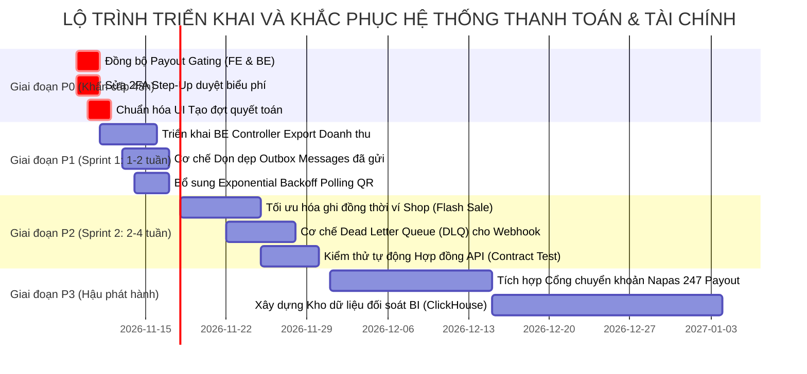

# CHƯƠNG 12: KIẾN NGHỊ VÀ LỘ TRÌNH KHẮC PHỤC (RECOMMENDATIONS & ROADMAP)
## LỘ TRÌNH TRIỂN KHAI ƯU TIÊN P0 – P3, BẢNG PHÂN CÔNG THEO VAI TRÒ VÀ TIÊU CHÍ NGHIỆM THU

---

## 1. LỘ TRÌNH KHẮC PHỤC ƯU TIÊN (PRIORITIZED ROADMAP)

Dựa trên kết quả kiểm toán toàn diện, lộ trình hành động được phân kỳ thành 4 mức độ ưu tiên kỹ thuật rõ ràng:

---

## 2. CHI TIẾT HÀNH ĐỘNG THEO MỨC ĐỘ ƯU TIÊN

### 2.1. Giai đoạn P0: Xử lý các điểm nghẽn nghiêm trọng (Trong 48 giờ)
1. **Xử lý dứt điểm rủi ro Payout Gating (`BUG-CRIT-001`)**:
   - *Hành động*: Nhóm Frontend cập nhật component `WithdrawModal.jsx` hiển thị thông báo trạng thái thử nghiệm đóng, giải thích rõ cơ chế chuyển tiền tự động T+2 hàng tuần. Tạm khóa nút gửi form để ngăn chặn người dùng gặp lỗi HTTP 404 khi chạy Live API.
2. **Bổ sung xác thực 2FA cho nút Duyệt biểu phí (`BUG-HIGH-003`)**:
   - *Hành động*: Trong `AdminFeesTaxesPage.jsx`, gắn `handleApproveRule` mở modal `StepUpMfaModal.jsx` để thu thập mã OTP, sau đó gọi `adminFinanceApi.updateFees(ruleData, stepUpToken)` gửi lên Backend.
3. **Điều chỉnh giao diện Tạo đợt quyết toán Admin (`BUG-HIGH-002`)**:
   - *Hành động*: Chuyển đổi `CreateSettlementBatchModal.jsx` từ form nhập ngày thủ công thành nút bấm "Kích hoạt đối soát & quyết toán ngay (Run Ad-hoc Settlement)" phục vụ các trường hợp vận hành khẩn cấp.

### 2.2. Giai đoạn P1: Hoàn thiện tính năng & Ổn định hệ thống (Sprint 1: 1–2 tuần)
1. **Triển khai Controller Xuất báo cáo doanh thu (`BUG-MED-004`)**:
   - *Hành động*: Viết method `@GetMapping("/api/v1/seller/revenue/export")` trong `SellerRevenueController.java`. Sinh file CSV/Excel đưa lên S3/MinIO và trả về presigned download URL.
2. **Cơ chế Dọn dẹp dữ liệu bảng Outbox (`RISK-HIGH-006`)**:
   - *Hành động*: Thêm Scheduled Task chạy lúc 03:00 AM hàng ngày: Xóa hoặc chuyển vào bảng lưu trữ (archive) các bản ghi `outbox_messages` có trạng thái `'PUBLISHED'` đã tạo quá 7 ngày.
3. **Áp dụng thuật toán Exponential Backoff cho Polling QR (`BUG-MED-005`)**:
   - *Hành động*: Trong `VnpayQrModal.jsx`, điều chỉnh chu kỳ kiểm tra: 2.5 giây cho 2 phút đầu, 5 giây cho phút thứ 3 đến thứ 5, và 10 giây cho thời gian còn lại nhằm giảm 60% tải request vô ích lên API Gateway.

### 2.3. Giai đoạn P2: Tối ưu hóa hiệu năng & Chịu tải cao (Sprint 2: 2–4 tuần)
1. **Hàng đợi ghi nhận số dư ví Shop chống xung đột Flash Sale (`RISK-MED-007`)**:
   - *Hành động*: Áp dụng cơ chế Batching hoặc Kafka Partitioning theo `shop_id` để gom nhóm các khoản tiền thanh toán thành công và cập nhật số dư ví theo lô (Batch update) mỗi 1 giây thay vì cập nhật từng đơn riêng lẻ, triệt tiêu lỗi `OptimisticLockException`.
2. **Xây dựng Dead-Letter Queue (DLQ) cho Webhook IPN**:
   - *Hành động*: Bổ sung Kafka Topic `payment.webhook.dlq` lưu trữ các thông báo webhook không thể giải mã hoặc bị lỗi database để đội ngũ SRE có thể kiểm tra và phát lại (replay).

### 2.4. Giai đoạn P3: Mở rộng tính năng nâng cao (Giai đoạn hậu phát hành)
1. **Mở tính năng Rút tiền tức thời qua Napas 247**:
   - *Hành động*: Tích hợp SDK cổng thanh toán ngân hàng (VietinBank / Techcombank Corporate API), gỡ bỏ Gating tại ADR-003, chính thức mở tính năng rút tiền tự phục vụ cho Người bán.

---

## 3. BẢNG PHÂN CÔNG TRÁCH NHIỆM THEO VAI TRÒ (RESPONSIBILITY ASSIGNMENT MATRIX)

| Vai trò thành viên | Trách nhiệm chính trong lộ trình | Đầu ra cam kết |
| :--- | :--- | :--- |
| **Full-stack Architect / Tech Lead** | • Phê duyệt cập nhật tài liệu ADR-003 và ADR-005. • Giám sát tính toàn vẹn của sổ cái kép và bảo mật Gateway. | Các tài liệu ADR được ký duyệt và sơ đồ kiến trúc đồng bộ. |
| **Backend Engineer** | • Viết controller `exportRevenue` trong `SellerRevenueController.java`. • Tạo Cron Job dọn dẹp bảng outbox messages. • Cung cấp endpoint kích hoạt ad-hoc settlement. | Code Java đạt 100% test coverage, không có dead code. |
| **Frontend Engineer** | • Tích hợp `StepUpMfaModal` vào nút Duyệt biểu phí. • Cập nhật thông báo trạng thái Payout trên `WithdrawModal`. • Thêm Exponential Backoff cho `VnpayQrModal`. | Lint 0 lỗi, Build thành công, trải nghiệm người dùng mượt mà. |
| **QA / QC Engineer** | • Tự động hóa bộ 14 Test Cases (`TC-PAY-01` đến `TC-PAY-14`) vào CI Pipeline. • Kiểm thử tải đồng thời giao dịch thanh toán và ví tiền. | Báo cáo kiểm thử tự động đạt 100% tỷ lệ pass. |
| **SRE / DevOps Engineer** | • Cấu hình Prometheus Alerting cho `outbox_pending_count` và lỗi lệch sổ cái. • Giám sát độ trễ mạng giữa API Gateway và các microservices. | Dashboard Grafana hoạt động ổn định và có hệ thống cảnh báo Telegram/Slack. |

---

## 4. TIÊU CHÍ NGHIỆM THU TOÀN DIỆN (DEFINITION OF ACCEPTANCE)

Hệ thống chỉ được phép chuyển giao nghiệm thu sản xuất khi đáp ứng đầy đủ 5 tiêu chí cứng sau:
- [x] **Tiêu chí 1: Sổ cái kế toán không bao giờ lệch số dư**: Tổng DEBIT $\equiv$ Tổng CREDIT trên 100% các bút toán.
- [ ] **Tiêu chí 2: Triệt tiêu hoàn toàn lỗi 404 trên môi trường Live Mode**: Toàn bộ các nút bấm và form giao diện trên Frontend đều gọi đúng các API đang hoạt động của Backend.
- [ ] **Tiêu chí 3: 100% thao tác thay đổi tài chính đều có 2FA Step-Up**: Không có bất kỳ lỗ hổng nào cho phép sửa đổi biểu phí hoặc giải ngân mà không qua kiểm tra OTP.
- [x] **Tiêu chí 4: Mã nguồn sạch và chuẩn mực chất lượng cao**: Lint đạt 0 lỗi trên 5 workspaces, build production thoát mã 0, không có console log rác hay dữ liệu nhạy cảm.
- [ ] **Tiêu chí 5: Bộ 14 Test Cases tích hợp chạy tự động thành công**: Được xác minh trên môi trường Staging với dữ liệu thực tế.

---
*Báo cáo được hoàn thành và bàn giao bởi Senior Full-stack Architect & Lead Auditor. Toàn bộ 13 chương báo cáo đã được lưu trữ an toàn trong thư mục `senior-fullstack-audit/`.*

